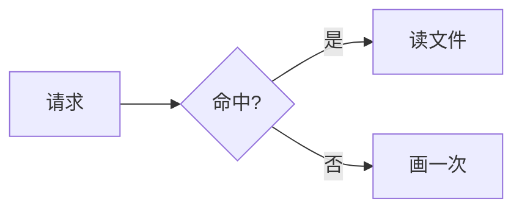

# Extending the syntax

> This section specifies the extension model, the syntax a document writes and
> the rules a definition follows.  The registry that runs definitions written
> outside the package is not implemented yet; the containers the package ships
> with are what a page can use today.

The page reads Markdown, and names inside a fenced container it does not know
it treats as an extension.  Everything an extension can do is built from three
primitives: a container, a layout, and the page's own tokens.  That is
deliberate.  A preview with twenty special-case blocks has twenty small rules,
and their differences show up as pages that look right in one theme and wrong
in another.  One primitive with twenty declarations has one rule.

### A container

```
:::card {title="缓存命中" tone=info}
图片和公式都按矢量画一次，之后按页面尺寸缩放。

- 命中时读文件
- 未命中时画一次
:::
```

`:::name` opens a container and `:::` closes it.  The body is ordinary
Markdown: paragraphs, lists, tables, fenced code, math, diagrams, and other
containers.  Nesting is recursive and allowed up to eight levels; a ninth is
reported rather than drawn.

The braces hold named parameters, `key=value`, separated by spaces.  A value
may be quoted when it contains spaces.  A container without parameters is
written without braces:

```
:::note
这一页的图都在页面自己的配色下画。
:::
```

### Parameters

A definition states the parameters it accepts and their types.  The types are
`string`, `number`, `bool`, `length`, `color`, `enum` and a regular expression.

| Type | Written as | Meaning |
| --- | --- | --- |
| `string` | `title="缓存命中"` | text, quoted when it holds a space |
| `number` | `level=2` | integer or decimal |
| `bool` | `open=true` | `true` or `false` |
| `length` | `width="40%"` | a number with `px`, `ch`, `vw` or `%` |
| `color` | `tone="#f85149"` | a hex colour, or a token name (see below) |
| `enum` | `tone=warning` | one of the declared words |
| regexp | `id="^[a-z]+$"` | a pattern the value must match |

A parameter the definition does not declare, or a value of the wrong type, is
not guessed at and not dropped.  The page keeps the container's source visible
and writes one line above it:

```
line 42: card does not accept "colour"; it accepts title, tone
line 42: card's tone is "urgent"; it accepts info, warning, danger
```

A page that fails loudly is a page whose author can fix it.

### Colours and sizes come from the page

A container may name a token, never a literal size.  The tokens are the ones
the page already uses: `page`, `ink`, `muted`, `panel`, `quote`, `border`,
`accent`, `danger`.  A colour parameter therefore reads `tone=warning` or
`background=panel`, not `background=#24262a`, because a literal that looks
right on a dark page is unreadable on a light one.

Type size is never a parameter.  It comes from the reader's Emacs, the way the
rest of the page does, and a container that needs to stand out uses weight,
space, a rule or a panel instead.

### A layout

`:::layout` arranges containers and prose in columns.  Its body is divided by
`:::col` markers, and each column holds Markdown.

```
:::layout {cols="2fr 1fr" gap="2ch"}
:::col
## 一次命中

缓存里只有一张图，命中时页面从磁盘读它，不再启动渲染器。


:::col
侧面说明写成普通段落就行，宽度由列决定，图仍然可以用整页宽度。
:::
```

`cols` takes a space-separated list of widths in `fr`, `ch` or `%`; `gap` takes
a length.  A column with no width shares what is left.  On a window too narrow
to hold the columns side by side, the layout stacks them in order; nothing is
dropped and nothing shrinks below the reading measure.

Complex layout is composition, not another language.  A column holds the same
Markdown as the page, so a card, a diagram, a table and a formula inside one
compose without a new rule for each.

### Unknown names

A document may travel to a machine whose definitions differ.  A name that is
not defined is not an error and not a guess: the block keeps its source, and
the page says which definition is missing.

```
:::stats {value=42}
:::
```

```
line 12: "stats" is not defined here; this block is shown as its source
```

The document still reads, the missing piece is visible, and adding the
definition makes it render without touching the text.

### Writing a definition

A definition is data, kept beside the package, not inside a document.  It names
the container, states its parameters, and returns a view built from the same
layout primitives the page uses.  Its shape is:

```elisp
(etaf-md-preview-define-container 'card
  :params '((title :string "") (tone (enum info warning danger) info))
  :body (lambda (params body env)
          (etaf-node 'column
                     (list :gap '(lh 0)
                           :pad '(ch 1)
                           :background (etaf-md-preview-token env :panel))
                     (list (etaf-node 'text
                                      (list :weight 'bold)
                                      (list (plist-get params :title)))
                           body))))
```

`body` is the container's parsed content, a list of views, not a string: the
definition decides arrangement, never parsing.  That is why a container can
hold anything the page holds, and why publishing, tables of contents, links,
search and per-block repainting keep working inside it.

### The rules that keep it one system

1. One syntax: `:::name {params}`.  A new effect is a new name, never a new
   punctuation.
2. One content model: a body is parsed Markdown, never HTML and never a string
   of markup.
3. One parameter system: values are checked against the definition before the
   body is built.
4. One set of layout primitives: `row`, `column`, `grid` with gap, alignment,
   padding and a token background.
5. One source of appearance: colours are tokens, type size is the reader's.
6. One failure rule: an unknown name or a bad parameter leaves the source
   visible with one line saying what is wrong.
