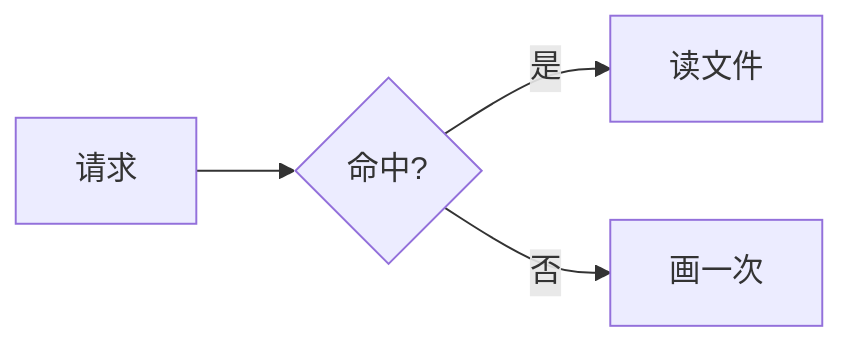

# 扩展语法

> 这一章说明扩展模型：文档能写什么语法，一个定义要遵守什么规则。把外部定义跑起来的
> 注册表还没实现；今天页面能用的是包自带的那些容器。

页面读 Markdown，碰到不认识的容器名字，就当作扩展。扩展能做的事，全部由三个原语拼出来：
容器、布局、页面自己的令牌。这是有意的。一个预览带二十个特例块，就有二十套小规矩，
它们之间的差别会变成「这套配色下好看，换个配色就难看」。一个原语配二十条声明，只有一套规矩。

## 容器

```
:::card {title="缓存命中" tone=info}
图片和公式都按矢量画一次，之后按页面尺寸缩放。

- 命中时读文件
- 未命中时画一次
:::
```

`:::name` 开启一个容器，`:::` 关闭它。里面是普通 Markdown：段落、列表、表格、围栏代码、
公式、图表，还有别的容器。嵌套可以递归，最多八层；到第九层会报错，不会画出来。

花括号里写具名参数，`键=值`，用空格分隔。值里有空格时加引号。没有参数的容器不写花括号：

```
:::note
这一页的图都在页面自己的配色下画。
:::
```

## 参数

一个定义要声明它收哪些参数、各是什么类型。类型有 `string`、`number`、`bool`、`length`、
`color`、`enum`，还有正则表达式。

| 类型 | 写法 | 含义 |
| --- | --- | --- |
| `string` | `title="缓存命中"` | 文本，含空格时加引号 |
| `number` | `level=2` | 整数或小数 |
| `bool` | `open=true` | `true` 或 `false` |
| `length` | `width="40%"` | 数字带 `px`、`ch`、`vw` 或 `%` |
| `color` | `tone="#f85149"` | 十六进制颜色，或者令牌名（见下） |
| `enum` | `tone=warning` | 定义里列出的词之一 |
| 正则 | `id="^[a-z]+$"` | 值必须符合这个模式 |

定义没有声明的参数、类型不对的值，既不猜，也不悄悄丢掉。页面保留容器的源码，并在它上方写一行：

```
line 42: card 不收 "colour"，它收 title、tone
line 42: card 的 tone 是 "urgent"，它只认 info、warning、danger
```

错误摆在明面上，作者才改得动。

## 颜色和尺寸都来自页面

容器可以写令牌，不能写死的尺寸。令牌就是页面本来在用的那些：`page`、`ink`、`muted`、
`panel`、`quote`、`border`、`accent`、`danger`。所以颜色参数写成 `tone=warning` 或
`background=panel`，不写 `background=#24262a`，因为一个在暗色页上好看的色值，换到亮色页
就没法读了。

字号永远不是参数。它来自读者的 Emacs，和页面其他地方一样。容器想让人一眼看到，用字重、
留白、一条线，或者一块底色，不动字号。

## 布局

`:::layout` 把容器和正文排成几栏。它的内容用 `:::col` 标记分开，每一栏里还是 Markdown。

```
:::layout {cols="2fr 1fr" gap="2ch"}
:::col
## 一次命中

缓存里只有一张图，命中时页面从磁盘读它，不再启动渲染器。


:::col
旁边的说明写成普通段落就行，宽度由栏决定，图仍然可以用整页宽度。
:::
```

`cols` 是一串用空格分开的栏宽，单位 `fr`、`ch` 或 `%`；`gap` 是一个长度。没写宽度的栏
分掉剩下的宽度。窗口窄到放不下并排的栏时，布局按顺序把栏叠起来：内容一样不少，也不会
缩到阅读宽度以下。

复杂的版面靠组合，不靠另一套语言。栏里装的是页面能装的同一套 Markdown，所以卡片、图表、
表格、公式放进去都能组合，不用为每一种再定一条规矩。

## 不认识的名字

文档可能被带到一台定义不一样的机器上。没有定义的名字不算错误，也不瞎猜：块保留源码，
页面说明缺的是哪个定义。

```
:::stats {value=42}
:::
```

```
line 12: 这里没有 "stats" 的定义，这一块按它的源码显示
```

文档照样能读，缺的那块看得见，补上定义就能渲染，正文一个字都不用改。

## 写一个定义

定义是数据，放在包旁边，不写进文档。它给容器起名、声明参数，并返回一棵视图，用的
是页面本来就有的布局原语。形状是这样：

```elisp
(etaf-md-preview-define-container 'card
  :params '((title :string "") (tone (enum info warning danger) info))
  :body (lambda (params body env)
          (etaf-node 'column
                     (list :gap '(lh 0)
                           :pad '(ch 1)
                           :background (etaf-md-preview-token env :panel))
                     (list (etaf-node 'text
                                      (list :weight 'bold)
                                      (list (plist-get params :title)))
                           body))))
```

`body` 是这个容器已经解析好的内容，一串视图，不是一个字符串：定义只决定怎么摆，从不碰
怎么解析。正因如此，容器里能装页面能装的任何东西，发布、目录、链接、搜索和单块重画
这些机制在容器内部也照常工作。


## 计划中的容器目录（尚未实现）

下面这些名字是设计清单，不是现有功能：注册表还没写，这些容器一个都还没实现。写在这里
是为了先把参数与用法定下来，实现时照着做，验收也照着验。今天页面能用的只有 `> [!NOTE]`
那一套提示块。

每一条给出参数、用法和它解决的问题。参数没写默认值时，该参数可以省略，省略后不占位置。

### `note`、`tip`、`important`、`warning`、`caution`

```
:::warning {title="兼容性"}
这段只在 Emacs 30 及以上可用。
:::
```

| 参数 | 类型 | 默认 | 说明 |
| --- | --- | --- | --- |
| `title` | string | 各类型的固定标题 | 换掉标题文字 |
| `collapsible` | bool | `false` | 允许折叠 |
| `open` | bool | `true` | 折叠时是否默认展开 |

`> [!NOTE]` 那套 GitHub 写法与它等价，两者渲染结果一样，选一种写就行。

### `card`

一张带标题的卡片，用来把相关的东西收在一起：一段说明加一张图、一组链接、一段代码。

| 参数 | 类型 | 默认 | 说明 |
| --- | --- | --- | --- |
| `title` | string | 无 | 卡片标题，省略则不画标题行 |
| `tone` | enum | `panel` | 底色：`panel`、`quote`、`accent`、`danger` |
| `href` | string | 无 | 整张卡片可点，跳到这个地址 |
| `cols` | enum | `1` | 内容分几栏：`1`、`2`、`3`，窄窗口自动降为一栏 |

### `steps`

编号的步骤序列。里面每个二级标题或 `:::` 子块算一步。

```
:::steps
### 定位
用 `sample` 抓栈，别先猜。

### 改因
改产生现象的那一层，不改它的结果。
:::
```

| 参数 | 类型 | 默认 | 说明 |
| --- | --- | --- | --- |
| `start` | number | `1` | 起始编号 |
| `style` | enum | `number` | `number` 用数字，`dot` 用小圆点 |

### `tabs`

同一位置的几份内容，读的人点标签切换。适合「三种写法各一份」这种并列。

```
:::tabs
:::tab {label="Emacs 29"}
用 `image-size` 的旧签名。
:::tab {label="Emacs 30+"}
直接传 buffer。
:::
```

| 参数 | 类型 | 默认 | 说明 |
| --- | --- | --- | --- |
| `label` | string | 必填 | 标签文字 |

标签是真实按键可达的，方向键左右切换，`RET` 激活。

### `collapse`

可以折叠的一段，默认收起。适合把长推导、长日志留在页面上但不挡路。

| 参数 | 类型 | 默认 | 说明 |
| --- | --- | --- | --- |
| `title` | string | 必填 | 收起时显示的标题 |
| `open` | bool | `false` | 是否默认展开 |

### `field`

「名称：值」的列表，用来写参数说明、环境信息、键值对。比表格轻。

```
:::field
- 版本：12.3.0
- 渲染器：Chromium，常驻
- 缓存：`~/.cache/etaf-md-preview/typeset`
:::
```

里面写列表，每项的第一个冒号前是名称。名称列宽自动对齐，值可以换行。

### `flex`

并排的几块，宽度按比例分。做「图在左、说明在右」这种版式。

| 参数 | 类型 | 默认 | 说明 |
| --- | --- | --- | --- |
| `gap` | length | `2ch` | 块之间的间距 |
| `align` | enum | `start` | 交叉轴对齐：`start`、`center`、`end`、`stretch` |

子块用 `:::flex-item {grow=2}` 给出比例，没写比例的平分剩余宽度。

### `timeline`

按时间排列的事件，每条一行。适合版本记录、事故经过。

```
:::timeline
- 2026-11-12：定位到 `image-size` 会真的画图
- 2026-11-13：改成读文件头，打开从 5.4 秒降到 0.33 秒
:::
```

| 参数 | 类型 | 默认 | 说明 |
| --- | --- | --- | --- |
| `marker` | enum | `dot` | 时间轴上的记号：`dot`、`number`、`none` |

### `stats`

一组数字，横向排开，每个带一行说明。适合报告开头放结论。

```
:::stats
- 打开：0.33 s
- 缩放：0.18 s
- 内存：349 MB
:::
```

每个数字用一种令牌色（依次是 `accent`、`ink`、`muted`），超出三项时换行。

### `layout` 与 `flex`、`card` 的关系

三个都能排多栏，用途不同：`layout` 是整页级的版式，`flex` 是块内的等比分配，
`card` 是把内容收进一块有边界的区域。选最窄的那个就够用的，不要把 `layout` 当 `flex`。

## 让它保持一套系统的六条规则

1. 一种语法：`:::name {params}`。新效果用新名字，不用新标点。
2. 一个内容模型：内容是解析过的 Markdown，不是 HTML，也不是一段标记字符串。
3. 一套参数系统：搭内容之前，值先按定义校验。
4. 一组布局原语：`row`、`column`、`grid`，配间距、对齐、内边距和令牌底色。
5. 一个外观来源：颜色取令牌，字号取读者的。
6. 一条失败规则：名字没定义或者参数不对，源码留着，加一行说明哪里错了。
