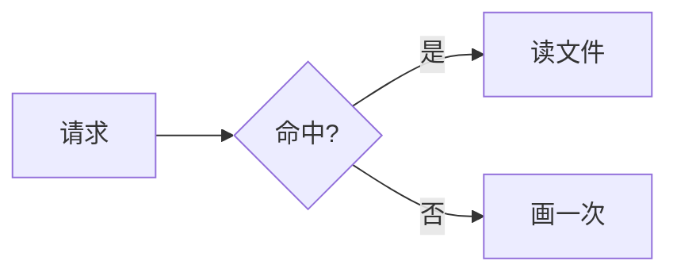

# 扩展语法

> 这一章是契约：文档里能写什么、一个定义要遵守什么。运行外部定义的注册表还没实现，
> 现在页面能用的是包自带的块。

页面读 Markdown。遇到它不认识的容器名字，就当作扩展。扩展能做的事只用三个原语拼出来：
容器、布局、页面的主题令牌。

这么定是吃过亏的。一个预览带二十个特例块，就有二十套小规矩，差异最后会变成
「暗色下好看、亮色下难看」。一个原语配二十条声明，只有一套规矩。

## 容器

```
:::card {title="缓存命中" tone=info}
图片和公式都按矢量画一次，之后按页面尺寸缩放。

- 命中时读文件
- 未命中时画一次
:::
```

`:::name` 开始，`:::` 结束。里面是普通 Markdown：段落、列表、表格、代码、公式、图表，
还能再套容器。嵌套最多八层，第九层直接报错，不会画出来。

花括号里写参数，`键=值`，空格分隔。值里有空格就用引号。没有参数就不写花括号：

```
:::note
这一页的图都按页面自己的配色画。
:::
```

## 参数

定义里写清收哪些参数、什么类型。类型有 `string`、`number`、`bool`、`length`、`color`、
`enum` 和正则。

| 类型 | 写法 | 含义 |
| --- | --- | --- |
| `string` | `title="缓存命中"` | 文本，有空格就加引号 |
| `number` | `level=2` | 整数或小数 |
| `bool` | `open=true` | 只有 true 和 false |
| `length` | `width="40%"` | 数字带 px、ch、vw 或 % |
| `color` | `tone=warning` | 主题令牌，或者十六进制颜色 |
| `enum` | `tone=warning` | 定义里列出的那几个词之一 |
| 正则 | `id="^[a-z]+$"` | 值必须匹配这个模式 |

定义没写的参数、类型不对的值，既不猜也不悄悄丢掉。页面保留源码，上面写一行：

```
第 42 行：card 不收 colour，它收 title、tone
第 42 行：card 的 tone 是 urgent，只认 info、warning、danger
```

错在页面上看得见，作者才改得动。

## 颜色和字号

颜色只能写令牌，不能写死的色值。令牌就是页面本来在用的那些：`page`、`ink`、`muted`、
`panel`、`quote`、`border`、`accent`、`danger`。

所以参数写 `tone=warning` 或 `background=panel`，不写 `background=#24262a`。
写死的颜色在暗色页上好看，换到亮色页就没法读了。

字号永远不是参数。它来自读者的 Emacs，和页面其他部分一样。要突出某一块，用字重、
留白、一条线或者一块底色，不动字。

## 布局

`:::layout` 把容器和正文排成几栏。栏用 `:::col` 分隔，每栏里还是 Markdown。

```
:::layout {cols="2fr 1fr" gap="2ch"}
:::col
## 一次命中

缓存里只有一张图。命中就读磁盘，不再起渲染器。


:::col
旁边这栏写补充说明就行。宽度由栏决定，图照样能用整页宽。
:::
```

`cols` 是空格分隔的栏宽，单位 `fr`、`ch` 或 `%`；`gap` 是间距。没写宽度的栏分剩下的。
窗口窄到放不下并排的栏，就按顺序叠起来，不丢内容，也不缩字。

复杂的版式靠组合，不靠第二套语言。栏里装的是页面能装的同一套东西，一张卡片、一张图、
一张表、一条公式放进去都不用另加规矩。

## 不认识的名字

文档会流传到定义不一样的机器上。没定义的名字不算错误，也不瞎猜：块保留源码，页面
写清缺哪个定义。

```
:::stats {value=42}
:::
```

```
第 12 行：这里没有 stats 的定义，这一块按原文显示
```

文档照样能读，缺的东西摆在明面上，补上定义就能正常渲染，正文一个字不用改。

## 写一个定义

定义是数据，放在包旁边，不写进文档。它给容器起名、说明参数，再返回一棵用页面
本来就有的布局原语搭出来的视图。形状是这样：

```elisp
(etaf-md-preview-define-container 'card
  :params '((title :string "") (tone (enum info warning danger) info))
  :body (lambda (params body env)
          (etaf-node 'column
                     (list :gap '(lh 0)
                           :pad '(ch 1)
                           :background (etaf-md-preview-token env :panel))
                     (list (etaf-node 'text
                                      (list :weight 'bold)
                                      (list (plist-get params :title)))
                           body))))
```

`body` 是已经解析好的视图列表，不是字符串。定义只决定怎么摆，不碰怎么解析。正因如此，
容器里装什么都成立，发布、目录、链接、搜索、单块重画这些机制也照常工作。

## 让它是一套系统，而不是一堆特例

1. 一种语法：`:::name {params}`。新效果加名字，不加标点。
2. 一个内容模型：容器里永远是解析过的 Markdown，不用 HTML，不用标记字符串。
3. 一套参数：先按定义校验，再搭内容。
4. 一组布局原语：`row`、`column`、`grid`，配间距、对齐、内边距和令牌底色。
5. 一个外观来源：颜色取令牌，字号取读者的。
6. 一条失败规则：名字没定义或者参数不对，源码留着，加一行说明哪里错了。
