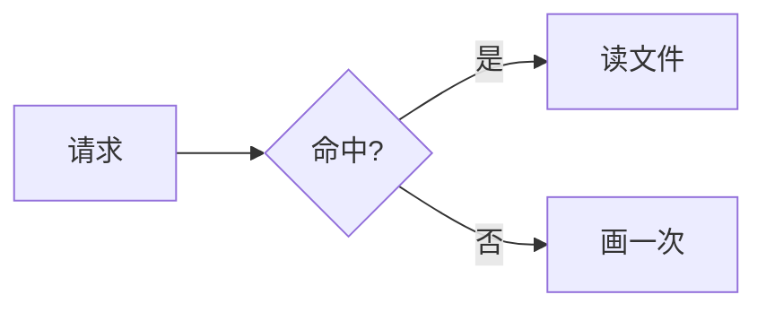

# ETAF Markdown Preview manual

This manual covers the workflows a reader performs. The root entry's
Commentary owns the supported API inventory; this document links to it instead
of repeating signatures.

## Keys

| Key | Action |
| --- | --- |
| `n` / `p` | Move to the next / previous heading of the document |
| `C-c j` | Choose a heading from a completion list |
| `e` | Edit the block under point as its markdown source |
| `RET`, mouse-1 | Activate the link or image under point; play or pause a video |
| `r` | Re-read the file and repaint |
| `t` | Cycle the palette (dark, light, sepia) |
| `[` / `]` | Narrow / widen the maximum reading measure by four columns |
| `?`, `C-c h` | Search the current key bindings in an in-buffer help modal |
| `q` | Unmount the preview and kill its buffer |
| `C-s`, `C-v`, `M-v`, wheel | Native isearch and scrolling |

The buffer is an ordinary Emacs buffer, so isearch, `occur`, window splitting,
`C-x C-s`-style buffer handling and `imenu` all keep working. `M-x imenu`
lists the document outline. Help stays in the preview window and follows its
theme. `/` searches; Escape first leaves search editing, then closes help.
Clicking outside the panel also closes it and restores the reading focus.

## Supported Markdown

The parser covers CommonMark blocks and inlines plus the GitHub extensions a
preview needs:

- Headings: ATX (`#` … `######`) and Setext (`===`, `---`), with stable
  anchors used by tables of contents and `#fragment` links.
- Paragraphs with emphasis, strong emphasis, strikethrough, inline code,
  links (inline, reference and shortcut), autolinks and raw inline HTML
  (rendered literally).
- Fenced code blocks with an info string (shown as a language tag) and
  indented code blocks; long lines wrap so no code is hidden.
- Blockquotes, nested ordered and unordered lists, and task list items
  (`- [x]`, `- [ ]`).
- Pipe tables with left, center and right alignment, drawn as a full grid
  with an outer frame, row and column separators and a header rule.
- GitHub alerts (`> [!NOTE]`, `[!TIP]`, `[!IMPORTANT]`, `[!WARNING]`,
  `[!CAUTION]`) rendered as titled callout blocks.
- Thematic breaks, character references, backslash escapes and hard line
  breaks.
- Footnotes: `[^label]` references render numbered and definitions collect at
  the end of the document; activating a reference jumps to its definition.
- YAML front matter is removed from the body; its `title` becomes the document
  title and its author, date, version, license and status keys render in a
  title area at the top of the document.

`etaf-md-preview-create` selects the dialect with its `:flavor` argument:
`gfm` (the default) enables the GitHub extensions and front matter,
`commonmark` parses the core specification only, and a feature plist such as
`(:tables t :task-lists nil)` toggles individual extensions.

Image syntax and HTML `` / `<video>` tags render as media cards. Relative paths resolve against the document's directory. A local image
renders through ETAF's image Host; a local video starts as a still poster
(its first frame through the image Host) and RET (or a click) mounts the
native video Component to play it in place. Further presses on the playing
card toggle play/pause without leaving Emacs. Without ffmpeg on `exec-path`
the card keeps the poster and RET opens the video in the operating system's
default player.
Remote images render a labeled placeholder whose activation
opens the URL. A missing or unreadable file renders a placeholder card, never
an error.

## Extending the syntax

> This section specifies the extension model, the syntax a document writes and
> the rules a definition follows.  The registry that runs definitions written
> outside the package is not implemented yet; the containers the package ships
> with are what a page can use today.

The page reads Markdown, and names inside a fenced container it does not know
it treats as an extension.  Everything an extension can do is built from three
primitives: a container, a layout, and the page's own tokens.  That is
deliberate.  A preview with twenty special-case blocks has twenty small rules,
and their differences show up as pages that look right in one theme and wrong
in another.  One primitive with twenty declarations has one rule.

### A container

```
:::card {title="缓存命中" tone=info}
图片和公式都按矢量画一次，之后按页面尺寸缩放。

- 命中时读文件
- 未命中时画一次
:::
```

`:::name` opens a container and `:::` closes it.  The body is ordinary
Markdown: paragraphs, lists, tables, fenced code, math, diagrams, and other
containers.  Nesting is recursive and allowed up to eight levels; a ninth is
reported rather than drawn.

The braces hold named parameters, `key=value`, separated by spaces.  A value
may be quoted when it contains spaces.  A container without parameters is
written without braces:

```
:::note
这一页的图都在页面自己的配色下画。
:::
```

### Parameters

A definition states the parameters it accepts and their types.  The types are
`string`, `number`, `bool`, `length`, `color`, `enum` and a regular expression.

| Type | Written as | Meaning |
| --- | --- | --- |
| `string` | `title="缓存命中"` | text, quoted when it holds a space |
| `number` | `level=2` | integer or decimal |
| `bool` | `open=true` | `true` or `false` |
| `length` | `width="40%"` | a number with `px`, `ch`, `vw` or `%` |
| `color` | `tone="#f85149"` | a hex colour, or a token name (see below) |
| `enum` | `tone=warning` | one of the declared words |
| regexp | `id="^[a-z]+$"` | a pattern the value must match |

A parameter the definition does not declare, or a value of the wrong type, is
not guessed at and not dropped.  The page keeps the container's source visible
and writes one line above it:

```
line 42: card does not accept "colour"; it accepts title, tone
line 42: card's tone is "urgent"; it accepts info, warning, danger
```

A page that fails loudly is a page whose author can fix it.

### Colours and sizes come from the page

A container may name a token, never a literal size.  The tokens are the ones
the page already uses: `page`, `ink`, `muted`, `panel`, `quote`, `border`,
`accent`, `danger`.  A colour parameter therefore reads `tone=warning` or
`background=panel`, not `background=#24262a`, because a literal that looks
right on a dark page is unreadable on a light one.

Type size is never a parameter.  It comes from the reader's Emacs, the way the
rest of the page does, and a container that needs to stand out uses weight,
space, a rule or a panel instead.

### A layout

`:::layout` arranges containers and prose in columns.  Its body is divided by
`:::col` markers, and each column holds Markdown.

```
:::layout {cols="2fr 1fr" gap="2ch"}
:::col
## 一次命中

缓存里只有一张图，命中时页面从磁盘读它，不再启动渲染器。


:::col
侧面说明写成普通段落就行，宽度由列决定，图仍然可以用整页宽度。
:::
```

`cols` takes a space-separated list of widths in `fr`, `ch` or `%`; `gap` takes
a length.  A column with no width shares what is left.  On a window too narrow
to hold the columns side by side, the layout stacks them in order; nothing is
dropped and nothing shrinks below the reading measure.

Complex layout is composition, not another language.  A column holds the same
Markdown as the page, so a card, a diagram, a table and a formula inside one
compose without a new rule for each.

### Unknown names

A document may travel to a machine whose definitions differ.  A name that is
not defined is not an error and not a guess: the block keeps its source, and
the page says which definition is missing.

```
:::stats {value=42}
:::
```

```
line 12: "stats" is not defined here; this block is shown as its source
```

The document still reads, the missing piece is visible, and adding the
definition makes it render without touching the text.

### Writing a definition

A definition is data, kept beside the package, not inside a document.  It names
the container, states its parameters, and returns a view built from the same
layout primitives the page uses.  Its shape is:

```elisp
(etaf-md-preview-define-container 'card
  :params '((title :string "") (tone (enum info warning danger) info))
  :body (lambda (params body env)
          (etaf-node 'column
                     (list :gap '(lh 0)
                           :pad '(ch 1)
                           :background (etaf-md-preview-token env :panel))
                     (list (etaf-node 'text
                                      (list :weight 'bold)
                                      (list (plist-get params :title)))
                           body))))
```

`body` is the container's parsed content, a list of views, not a string: the
definition decides arrangement, never parsing.  That is why a container can
hold anything the page holds, and why publishing, tables of contents, links,
search and per-block repainting keep working inside it.

### The rules that keep it one system

1. One syntax: `:::name {params}`.  A new effect is a new name, never a new
   punctuation.
2. One content model: a body is parsed Markdown, never HTML and never a string
   of markup.
3. One parameter system: values are checked against the definition before the
   body is built.
4. One set of layout primitives: `row`, `column`, `grid` with gap, alignment,
   padding and a token background.
5. One source of appearance: colours are tokens, type size is the reader's.
6. One failure rule: an unknown name or a bad parameter leaves the source
   visible with one line saying what is wrong.

## Theming and layout

`etaf-md-preview-theme` chooses the document's colors. The default `auto`
derives them from the active frame's own faces: the page keeps the Emacs
theme's background, muted text follows `shadow`, headings `outline-1`, links
`link`, callouts `success`/`warning`/`error`, and panel surfaces (code blocks,
table headers and stripes, rules) are small blends of the frame's background
toward its foreground. The preview therefore matches whatever Emacs theme is
active without painting a page background of its own. The fixed `dark`,
`light` and `sepia` palettes remain available when a self-contained page is
wanted: selecting one paints its page background. `t` cycles the fixed
palettes, `etaf-md-preview-set-theme` pins one, and the resulting colors are
published as `:ui-*` theme tokens, so shared ETAF UI components used inside
the preview follow them.

The reading measure is capped and centered in the window. The session stores a
maximum; the column stretches to the window and never exceeds it, so a narrow
window fills the available columns. The column keeps a two-cell gutter on each
side outside the measure, so the text never starts or ends on the window edge
and a table's border stays off the column where the renderer extends the last
cell's paint across the window's sub-cell remainder. `[` and `]` adjust the
maximum manually in both directions, and the result is clamped between
`etaf-md-preview-width-min` and `etaf-md-preview-width-max`. A window resize
reflows through the renderer's viewport update rather than rebuilding the
document, and because the preview publishes into one buffer, resizing never
restarts the session.

The narrowest useful window is the minimum measure plus the two gutters, about
44 columns. Below that a block that cannot shrink to the measure, such as a
table whose columns must keep their words whole, is clipped at the measure
instead of painting over the gutter; text still wraps and the page keeps its
layout.

## Following the source

An opened preview follows its source buffer: each edit repaints the document
on the next frame, about 16 ms later, so a typing hand sees the render change
as it types. A burst of keys coalesces into one repaint per frame, and a save
or an outside write takes the same path. Each top-level block is published as its own
Component, keyed by its type and source text, so a repaint renders the block
that changed and keeps every other block's rendered output, video handles and
reading position. Inserting or removing a block re-renders the blocks after
it, because their position changed; typing inside a block never does.

## Editing a block in place

`e` edits the block under point without leaving the preview. The block swaps
its render for the text it was parsed from, on a slightly darker panel with an
accent bar down its left edge, and a native edit session opens on that text:
the caret, motion, selection, kill ring, undo and input methods are the
buffer's own, IME included. Every change goes into the source buffer as it is
typed, so the file, its buffer and the preview never disagree; the source
buffer keeps one undo step per visit.

`ESC`, a click outside the block or closing the preview ends the session and
renders the block again from the text as it now stands. That is also how a
block changes kind: delete a heading's marker and its paragraph appears
without it, add a blank line inside a paragraph and the two halves become
separate blocks. An outside change to the file ends the session before the
document is published again, so the preview never drops what was typed.

While a block is edited its own text is the source of truth: the rest of the
document keeps the render from the last parse until the session ends. Tables,
code fences, quotes and list items are all edited as their markdown text,
which is how their notation can be changed at all.

## Customization

Four options cover the supported personalization; every other appearance
decision follows the document and the frame.

| Option | Default | Effect |
| --- | --- | --- |
| `etaf-md-preview-theme` | `auto` | Initial palette; `auto` derives the colors from the Emacs theme's faces and paints no page background. |
| `etaf-md-preview-flavor` | `gfm` | Default Markdown dialect when `etaf-md-preview-create` gets no `:flavor`. |
| `etaf-md-preview-width-min` | `40` | Narrowest reading measure, in character cells. |
| `etaf-md-preview-width-max` | `96` | Widest reading measure; a wider window keeps it and centers the column. |

## Scripting and headless use

`etaf-md-preview-create` builds a session from a file or from text without any
buffer; `etaf-md-preview-view` returns the mountable view; `etaf-md-preview-state`
reports a detached snapshot. A session created from text is a complete
headless preview, which is what the acceptance tests use:

```elisp
(let* ((session (etaf-md-preview-create :text "# Notes\n\n**bold** body.\n"))
       (buffer (etaf-md-preview-open session)))
  (etaf-md-preview-locate session 0)
  (etaf-md-preview-set-theme session 'sepia)
  (etaf-md-preview-refresh session)
  (with-current-buffer buffer (etaf-md-preview-close)))
```

`etaf-md-preview-open` accepts a file path or a session, so callers can render
a document they built themselves. `etaf-md-preview-locate` moves point to an
outline index; `etaf-md-preview-outline` returns the outline itself.

`scripts/md-preview-gui-probe.el` drives a live frame for GUI verification: it
opens a document at a given frame size, reports one-line state, sends real
keys and checks layout invariants (no over-wide line, an interactive link, an
outline).

## Troubleshooting

- **A heading jump lands on the wrong occurrence.** Heading navigation finds
  the rendered heading text at the start of a buffer line, in outline order.
  Two headings with identical text are matched in order; an unusual document
  whose paragraph starts with the same text at line start may be matched
  first.
- **An image shows dots or a colored block grid.** The frame has no usable
  graphics support for that file, so Ebox fell back to its terminal
  converters; install ffmpeg for better terminal rendering, or view the file
  in a graphical frame.
- **A video opens in the system player instead of playing inline.** ffmpeg is
  not available on `exec-path`, so the card keeps its poster fallback.
- **RET on a finished video restarts it from the beginning.** A completed
  video has no paused state left to resume, so the next press replays it. The
  last frame stays on the canvas until then, and a short clip may have ended
  before the next press.
- **Theme changes do not repaint shared components.** The preview publishes
  its palette for its own subtree only; a surrounding application keeps its
  own theme context.
