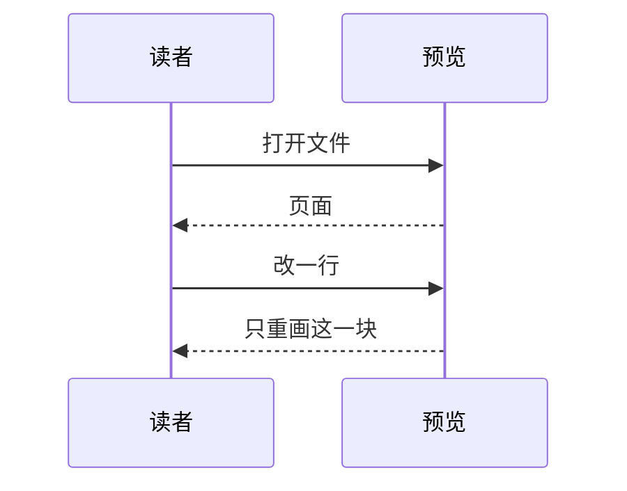
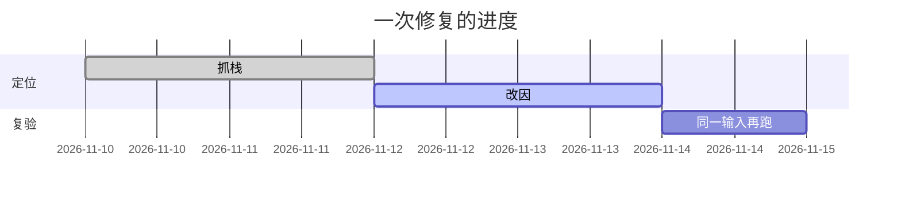
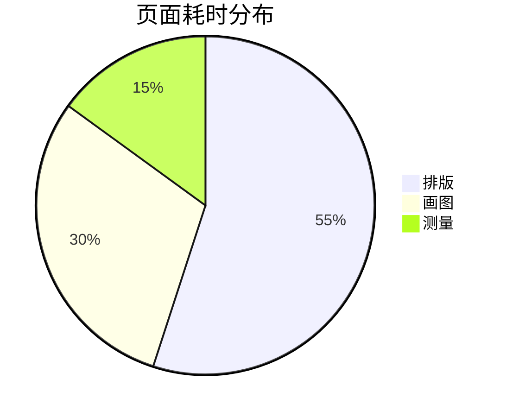

这一页按「基础语法、容器、站点组件、图表」四部分把预览支持的写法各写一遍：先给源码，紧跟它的渲染结果。左边源码、右边页面，对照着检查；改完渲染器，先打开这里看有没有退化。

# 一、基础语法

## 标题

一级到六级都用 `#`，最多六级。

# 一级标题

## 二级标题

### 三级标题

#### 四级标题

##### 五级标题

###### 六级标题

也可以只给文字，下一行写 `===` 或 `---`，这是 Setext 写法，只分两级。

Setext 一级标题
================

Setext 二级标题
----------------

## 段落与换行

一个空行分段，同一段里的换行按空格接上。行尾留两个空格是硬换行，下一行另起一行：  
这一行就另起了。

## 行内样式

**粗体**、*斜体*、~~删除线~~、`行内代码`，可以叠加：**粗体里有 `code` 和 *斜体***。

高亮用 `==`：==标记这一句==，也可以带配色：==成功=={.success}、==警告=={.warning}、==危险=={.danger}。

上下标：H~2~O、E = mc^2^。行内公式写 `$...$`，例如 $O(n \log n)$。

## 行内记号

四种记号可以放在同一句里：==高亮==、::check:: 图标、:kbd[Ctrl+B] 按键、:badge[v2]{.tip} 徽章，再加一个表情 :tada:。

按键的三种写法：:kbd[Esc]、:kbd[Ctrl+Shift+P]、:kbd[Cmd+K]。

徽章的配色：:badge[稳定]{.success}、:badge[实验]{.warning}、:badge[废弃]{.danger}、:badge[新]{.info}。

图标只看名字：::check::、::close::、::bell-off::、::search::。

## 链接与图片

行内链接：[ETAF 主页](https://etaf.top/)，带标题的写法：[文档](https://etaf.top/ "ETAF")。裸地址也能认出来：https://github.com/emacs-taf 。

行内图片： 会画成小图块，整段只有一张图时画成图片卡。

## 列表

- 无序列表的一项
- 第二项
  - 嵌套的一项
  - 嵌套的另一项
- 第三项

1. 有序列表第一项
2. 第二项
   1. 嵌套的一步
   2. 嵌套的另一步

- [x] 已完成的任务
- [ ] 未完成的任务

术语列表：

渲染器
: 把节点画成页面的那一层

容器
: 文档里写得出名字的块

## 引用与提示

> 引用块的第一段。
>
> 第二段，里面可以写 `代码` 和[链接](https://etaf.top/)。

GitHub 提示块也照常认：

> [!NOTE]
> 说明一件事。

> [!WARNING]
> 这里会出错。

## 表格

| 属性 | 类型 | 默认 |
| --- | --- | --- |
| `title` | string | 无 |
| `columns` | number | 3 |

对齐写在对齐行里：

| 左对齐 | 居中 | 右对齐 |
| :--- | :---: | ---: |
| a | b | c |
| 一 | 二 | 三 |

## 代码块

标题、行号、行高亮、行状态都写在围栏第一行。标题写在 `title=` 里；`:line-numbers` 开行号；花括号里的行号刷高亮；行尾的 `[!code ...]` 标记这一行怎么画。

```elisp title="lisp/etaf-md-env.el" :line-numbers
(defun etaf-md--hairline (env)
  "Return a one-pixel border as the Theme ENV's page lives in defines it."
  (etaf-theme-token
   :ui-panel-border
   (or (etaf-md--palette-value (etaf-md-env-palette env) :border)
       "#3a3f4b")))
```

```elisp {3,6-7}
(defun etaf-md--muted (env)
  "Return the muted ink of ENV's palette."
  (or (etaf-md--palette-value (etaf-md-env-palette env) :muted)
      "#9198a1"))
```

新增、删除、警告、错误都用行尾标记：

```elisp
(defun etaf-md--toggle-line (env block line)
  (let ((open (etaf-md-block-state env :open)))        ; [!code --]
    (etaf-md-set-block-state env :open (not open))))   ; [!code ++]
```

```elisp
(defun etaf-md--fold (text width)
  (let ((rows (etaf-md--wrap text width)))  ; [!code warning]
    (mapconcat #'identity rows "\n")))      ; [!code error]
```

## 脚注

正文里写一个脚注[^1]，定义放在页面末尾。

[^1]: 脚注的正文，可以写 `代码` 与链接。

## 转义

星号、反引号、方括号前加反斜杠就按字面写：\*不是斜体\*、\`不是代码\`。

# 二、容器

容器用 `:::name {属性}` 开、`:::` 关。属性只写文档声明过的那些。

## 盒子

:::box {surface=sunken}
盒子给一段话换底色和左右留白。`surface` 取 `raised`、`sunken`、`page` 等。
:::

## 卡片

:::card {title="缓存命中" description="一张卡片的标题与摘要" icon="check"}
正文照常写：列表、代码、链接都能放。

- 卡片里的一项
- 另一项
:::

## 分栏

:::columns {columns=2}
:::col
左栏的一段话。栏宽由 `columns` 均分。
:::
:::col
右栏的一段话。
:::
:::

三栏、去掉栏间竖线：

:::columns {columns=3 divider=false}
:::col
第一栏
:::
:::col
第二栏
:::
:::col
第三栏
:::
:::

## 详情

:::details {title="展开看完整报错"}
```
Error: void-function etaf-md-open
```
:::

## 折叠

:::accordion
:::collapse {title="先看结论"}
结论写在最前面。
:::
:::collapse {title="再看原因"}
原因写在后面。
:::
:::

## 标签页

:::tabs
@tab Emacs 29
Emacs 29 的写法。
@tab {title="Emacs 30+" selected=true}
Emacs 30 起的写法。
:::

## 代码标签页

:::code-tabs
@tab
```elisp
(etaf-md-open "笔记")
```
@tab
```python
print("预览")
```
:::

## 步骤

子块写 `step`：

:::steps
:::step {title="定位"}
先用 `sample` 抓栈，别先猜。
:::
:::step {title="改因"}
改产生现象的那一层，不改它的结果。
:::
:::

也可以直接写有序列表，列表项的文字就是步骤标题：

:::steps
1. 读源码，找出产生现象的那一层
2. 改那一层，不改它的结果
:::

## 时间线

:::timeline
:::event {time="2026-11-12" title="定位到慢在画图"}
`image-size` 会真的把图画出来。
:::
:::event {time="2026-11-13" title="改成读文件头" status="success"}
打开从 5.4 秒降到 0.33 秒。
:::
:::

## 字段

一个参数一张卡：名字一行，状态徽标跟在后面，类型、默认值、引入版本一行，正文是说明。

:::field {name="text" type="string" default="空字符串" required=true since="0.1"}
要画成链接的文字，必填。
:::

:::field {name="width" type="number" default="46" deprecated="改用 max-width"}
图片卡的最大列数，超出页面宽度时自动收窄。
:::

## 数字组

:::stats
:::stat {title="打开" value="0.33 s"}
:::
:::stat {title="缩放" value="0.18 s"}
:::
:::stat {title="内存" value="349 MB"}
:::
:::

## 文件树

名字后用 `#` 写注释；`++` 是新增、`--` 是删除；`**名字**` 加粗；`...` 画一个占位项。

:::file-tree {title="lisp/"}
- **lisp/** # 渲染核心
  - **etaf-md-model.el** # 解析、派生与增量发布
  - etaf-md-views.el # 页面与媒体
  - ++ etaf-md-typeset.el # 这次新增的排版层
  - -- etaf-md-old.el # 已删除的旧实现
  - tests/
    - etaf-md-tests.el
- etaf-md.el
- …
:::

## 对话

`{发送者}` 开始一条消息，`{.}` 是自己，`{:时间}` 换一个时间。

:::chat {title="预览为什么还不刷新"}
{:2026-11-14 14:20}

{问}
预览为什么不刷新？

{.}
保存之后才刷新，改到一半不重排。

{:2026-11-14 15:02}

{问}
表格改一个格子也会整页重排吗？

{.}
不会，只有那一块重画。
:::

## 表格容器

容器给表格加标题、行列高亮和复制行。

:::table {title="三个版本的打开耗时" highlight-rows="3" highlight-columns="2" copy=true}
| 版本 | 耗时 | 内存 |
| --- | --- | --- |
| 0.1.9 | 5.4 s | 380 MB |
| 0.2.0 | 0.33 s | 92 MB |
| 0.3.0 | 0.18 s | 74 MB |
:::

## 窗口

:::window {title="etaf-md.el"}
窗口只画标题栏，内容照常写。
:::

## 源码树

左边文件列表，右边选中文件的代码。

:::code-tree {height=12}
@file lisp/etaf-md-env.el
```elisp
(defun etaf-md--hairline (env)
  (etaf-theme-token
   :ui-panel-border
   (or (etaf-md--palette-value (etaf-md-env-palette env) :border)
       "#3a3f4b")))
```
@file lisp/etaf-md-nodes.el
```elisp
(etaf-md--define-shipped 'chat
  :name "chat"
  :summary "一问一答的对话，不画气泡"
  :attrs '((title :type string)))
```
:::

## npm 命令

按固定命令表把 npm 命令改写成别的包管理器，不执行命令。

:::npm-to {tabs="npm,pnpm,yarn,bun"}
```sh
npm install etaf-md
npm run build
npm uninstall foo
```
:::

# 三、站点组件

这些组件来自站点首页的写法，在文档里同样能用。

## 首屏

:::home-box {title="把文档当页面读" description="一个首屏大块：强调标题、摘要、行动链接和正文都在里面。" href="https://etaf.top/"}
首屏里的正文照常写，列表、代码和链接都能放。
:::

## 图片卡片

:::image-card {src="etaf-md-preview-wide.png" title="预览截图" description="图片加标题与说明，边框贴着图片。"}
:::

## 链接卡片

:::link-card {href="https://github.com/emacs-taf" title="emacs-taf" description="ETAF 生态的源码都在这里。"}
:::

## npm 徽章

:::npm-badge {name="etaf-md" version="0.1.0" downloads="1.2k"}
:::

## 二维码

:::qrcode {text="https://etaf.top/" title="扫码打开 ETAF"}
:::

## 轮播

:::swiper
@slide {title="第一张"}
第一页正文。
:::
@slide {title="第二张"}
第二页正文。
:::
:::

# 四、图表

## Mermaid

围栏语言写 `mermaid`，有 `mmdc` 时画成图，没有时保留源码。








## 公式

行内公式 $e^{i\pi} + 1 = 0$ 跟着句子走。

$$
\int_0^1 x^2 \, dx = \frac{1}{3}
$$

# 五、检查清单

- 每一节都能在右边看到结果，没有失败行。
- 容器属性只写声明过的名字。
- 代码块的标题、行号、行状态都按预期出现。
- 图表有程序时出图，缺程序时保留源码。
