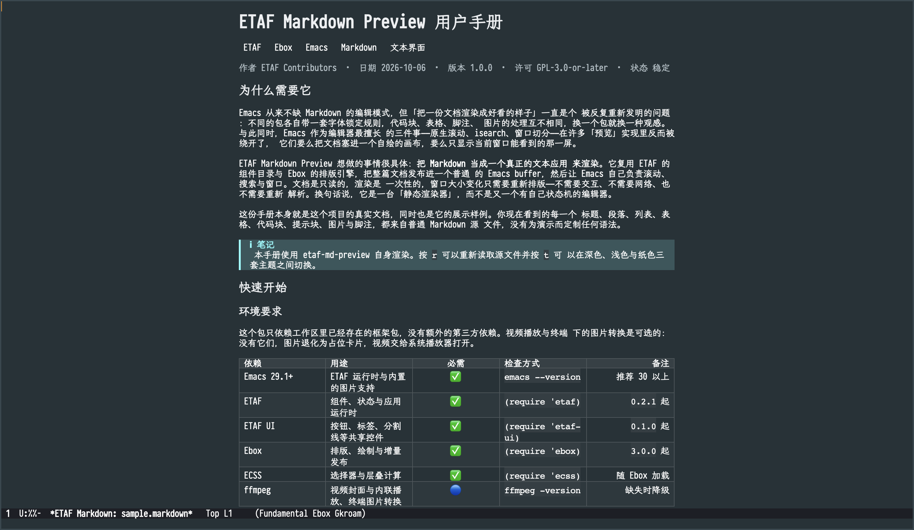
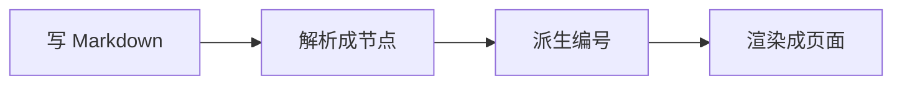
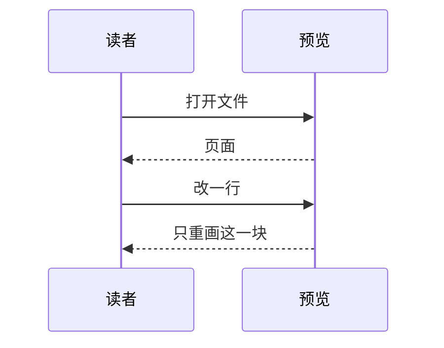
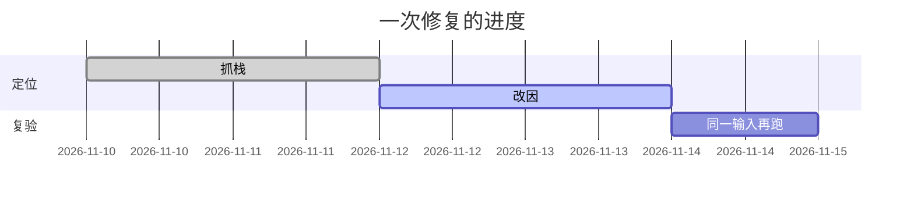
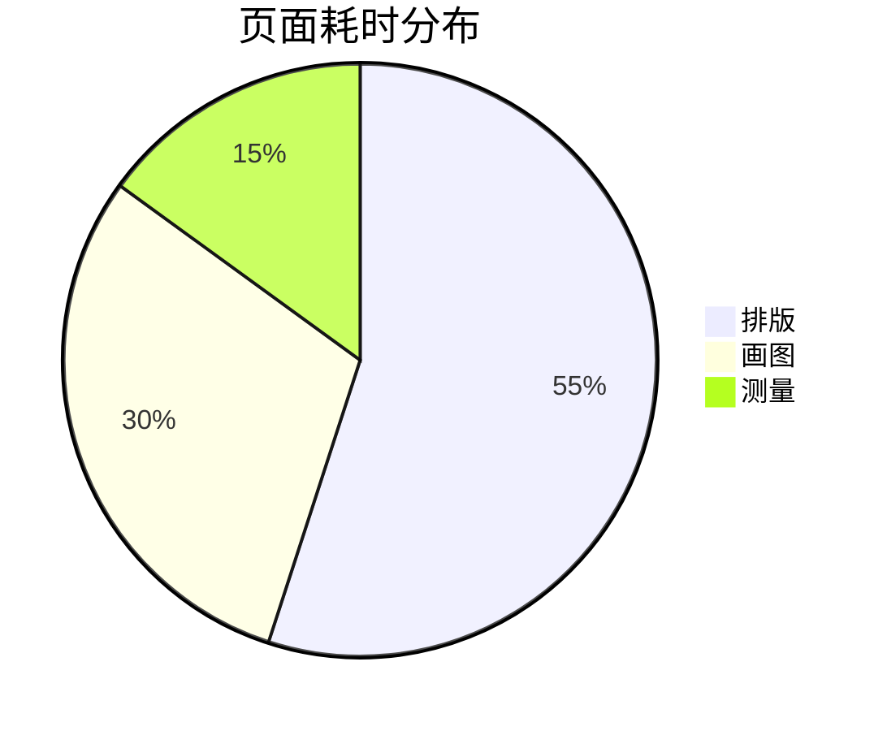

这一页是预览的语法清单：每个组件、每个属性、每个可选值都写一遍，先给源码，紧跟它的渲染结果。左边源码、右边页面，对照着检查；改完渲染器，先打开这里看有没有退化。

# 一、基础语法

## 标题

一级到六级都用 `#`。

# 一级标题

## 二级标题

### 三级标题

#### 四级标题

##### 五级标题

###### 六级标题

Setext 写法只分两级，文字下一行写 `===` 或 `---`。

Setext 一级标题
================

Setext 二级标题
----------------

标题里可以放行内样式：`code`、**粗体**、*斜体* 与 [链接](https://etaf.top/)。

## 段落与换行

空行分段；同一段的换行按空格接上。行尾两个空格是硬换行：  
这一行另起了。

## 行内样式

**粗体**、*斜体*、~~删除线~~、`行内代码`，可以叠加：**粗体里有 `code` 和 *斜体***。

高亮 `==…==` 有五种配色：

==默认高亮==、==成功=={.success}、==警告=={.warning}、==危险=={.danger}、==提示=={.tip}、==信息=={.info}。

上下标与行内公式：H~2~O、E = mc^2^、$O(n \log n)$。

## 行内记号

四种记号可以混在一句里：==高亮==、::check:: 图标、:kbd[Ctrl+B] 按键、:badge[v2]{.tip} 徽章，加一个表情 :tada:。

图标只看名字：::check::、::close::、::bell-off::、::search::。

按键：:kbd[Esc]、:kbd[Ctrl+Shift+P]、:kbd[Cmd+K]。

徽章四种配色：:badge[稳定]{.success}、:badge[实验]{.warning}、:badge[废弃]{.danger}、:badge[新]{.info}。

## 链接与图片

行内链接：[ETAF 主页](https://etaf.top/)，带标题：[文档](https://etaf.top/ "ETAF")。

引用式链接：先写 [文档][docs]，定义放在页面任意位置。

[docs]: https://etaf.top/ "ETAF 文档"

裸地址也能认：https://github.com/emacs-taf 。

行内图片  画成小图块；整段只有一张图时画成图片卡。

## 列表

- 无序列表的一项
- 第二项
  - 嵌套的一项
  - 嵌套的另一项
- 第三项

1. 有序列表第一项
2. 第二项
   1. 嵌套的一步
   2. 嵌套的另一步

- [x] 已完成的任务
- [ ] 未完成的任务

术语列表：

渲染器
: 把节点画成页面的那一层

容器
: 文档里写得出名字的块

## 引用与提示

> 引用块的第一段。
>
> 第二段，里面可以写 `代码` 与[链接](https://etaf.top/)。

GitHub 的提示块也照常认：

> [!NOTE]
> 一条说明。

> [!TIP]
> 一个小技巧。

> [!IMPORTANT]
> 必须知道的事。

> [!WARNING]
> 这里会出错。

> [!CAUTION]
> 别这么干。

## 表格

| 属性 | 类型 | 默认 |
| --- | --- | --- |
| `title` | string | 无 |
| `columns` | number | 3 |

三种对齐写在对齐行里：

| 左对齐 | 居中 | 右对齐 |
| :--- | :---: | ---: |
| a | b | c |
| 一 | 二 | 三 |

## 代码块

标题写在 `title=` 里，`:line-numbers` 开行号，`:line-numbers=3` 从 3 起，`:no-line-numbers` 关行号。

```elisp title="lisp/etaf-md-env.el" :line-numbers
(defun etaf-md--hairline (env)
  "Return a one-pixel border as the Theme ENV's page lives in defines it."
  (etaf-theme-token
   :ui-panel-border
   (or (etaf-md--palette-value (etaf-md-env-palette env) :border)
       "#3a3f4b")))
```

```elisp :line-numbers=3
(defun etaf-md--muted (env)
  (or (etaf-md--palette-value (etaf-md-env-palette env) :muted)
      "#9198a1"))
```

```elisp :no-line-numbers
(etaf-md-open "笔记")
```

花括号里的行号刷高亮：

```elisp {3,6-7}
(defun etaf-md--muted (env)
  "Return the muted ink of ENV's palette."
  (or (etaf-md--palette-value (etaf-md-env-palette env) :muted)
      "#9198a1"))
```

行尾标记决定这一行怎么画，标记本身不出现：

```elisp
(defun etaf-md--toggle-line (env block line)
  (let ((open (etaf-md-block-state env :open)))        ; [!code --]
    (etaf-md-set-block-state env :open (not open))))   ; [!code ++]
```

```elisp
(defun etaf-md--fold (text width)
  (let ((rows (etaf-md--wrap text width)))  ; [!code warning]
    (mapconcat #'identity rows "\n")))      ; [!code error]
```

```elisp
(defun etaf-md--focus (text)   ; [!code focus]
  (etaf-md--fold text 80))
```

标题行右侧有「复制」，把去掉标记的代码放进 kill ring。

## 脚注

正文里写脚注[^1]，也可以写第二个[^2]。

[^1]: 脚注的正文，可以写 `代码` 与链接。

[^2]: 第二个脚注。

## 转义

星号、反引号、方括号前加反斜杠就按字面写：\*不是斜体\*、\`不是代码\`、\[不是链接\]。

# 二、容器

容器用 `:::name {属性}` 开、`:::` 关。属性只写文档声明过的那些。

## 盒子 box

属性：`surface`、`padding`、`text-align`、`width`。

七种底色：

:::box {surface=none}
surface none：不画底色。
:::

:::box {surface=page}
surface page：页面底色。
:::

:::box {surface=raised}
surface raised：比页面亮一层的面。
:::

:::box {surface=sunken}
surface sunken：凹下去的面。
:::

:::box {surface=quote}
surface quote：引用的面。
:::

:::box {surface=table-header}
surface table-header：表头的面。
:::

:::box {surface=table-stripe}
surface table-stripe：表格条纹的面。
:::

内边距与宽度：

:::box {padding="6ch" width="40ch"}
padding 6ch、width 40ch：盒子只占四十列。
:::

:::box {text-align=center}
text-align center：盒子里的字居中。
:::

:::box {text-align=end}
text-align end：盒子里的字靠右。
:::

## 卡片 card

属性：`title`、`icon`、`description`、`href`、`accent`、`text-align`、`width`。

:::card {title="缓存命中" description="标题与摘要" icon="check"}
正文照常写：列表、代码、链接都能放。
:::

六种强调色：

:::card {title="neutral" accent="neutral"}
默认的强调色。
:::

:::card {title="primary" accent="primary"}
主色。
:::

:::card {title="success" accent="success"}
成功。
:::

:::card {title="warning" accent="warning"}
警告。
:::

:::card {title="danger" accent="danger"}
危险。
:::

:::card {title="important" accent="important"}
重要。
:::

整张卡片可点、限宽、内容居中：

:::card {title="打开 ETAF" description="整张卡片是一个链接" href="https://etaf.top/" width="40ch" text-align="center"}
点击卡片任何位置都会打开主页。
:::

## 分栏 columns

属性：`columns`、`gap`、`padding`、`min-width`、`align-items`、`justify-content`、`wrap`、`divider`、`align-self`。子块是 `col`。

两栏：

:::columns {columns=2}
:::col
左栏的一段话。
:::
:::col
右栏的一段话。
:::
:::

三栏、去掉栏间竖线：

:::columns {columns=3 divider=false}
:::col
第一栏
:::
:::col
第二栏
:::
:::col
第三栏
:::
:::

栏间距 6ch、左右留白 2ch：

:::columns {columns=2 gap="6ch" padding="2ch"}
:::col
左栏。
:::
:::col
右栏。
:::
:::

放不下就换行：

:::columns {columns=3 wrap=true min-width="20ch"}
:::col
一
:::
:::col
二
:::
:::col
三
:::
:::col
四
:::
:::

子块在交叉轴居中、主轴两端对齐：

:::columns {columns=2 align-items=center justify-content=between}
:::col
左
:::
:::col
右
:::
:::

## 详情 details

属性：`title`、`open`。默认收起。

:::details {title="展开看完整报错"}
```
Error: void-function etaf-md-open
```
:::

`open=true` 默认展开：

:::details {title="默认就展开" open=true}
这一块一进来就是展开的。
:::

## 折叠 accordion

属性：`expand`、`accordion`。子块是 `collapse`，属性 `title`、`open`、`index`。

默认同时只开一块：

:::accordion
:::collapse {title="先看结论"}
结论写在最前面。
:::
:::collapse {title="再看原因"}
原因写在后面。
:::
:::

`accordion=false` 可以同时开多块：

:::accordion {accordion=false}
:::collapse {title="第一块"}
可以同时展开。
:::
:::collapse {title="第二块"}
两块互不影响。
:::
:::

`expand=true` 打开页面时全部展开：

:::accordion {expand=true}
:::collapse {title="全部展开的第一块"}
:::
:::collapse {title="全部展开的第二块"}
:::
:::

`index` 决定顺序，`open=true` 默认展开：

:::accordion {accordion=false}
:::collapse {title="后写的先出现" index=1 open=true}
index 小的排前面。
:::
:::collapse {title="后写的后出现" index=2}
index 大的排后面。
:::
:::

## 标签页 tabs

子块是 `tab`，用 `@tab` 一行一个；`title` 必填，可以写在标记后面或花括号里，`selected` 选默认页。

:::tabs
@tab Emacs 29
Emacs 29 的写法。
@tab {title="Emacs 30+" selected=true}
Emacs 30 起的写法。
:::

## 代码标签页 code-tabs

同样用 `@tab`，`title` 可省，省略时取围栏的语言名。

:::code-tabs
@tab
```elisp
(etaf-md-open "笔记")
```
@tab
```python
print("预览")
```
:::

## 步骤 steps

属性：`start`、`list-style`。子块是 `step`，属性 `title`。

:::steps
:::step {title="定位"}
先用 `sample` 抓栈，别先猜。
:::
:::step {title="改因"}
改产生现象的那一层，不改它的结果。
:::
:::

`start=0` 从零编号：

:::steps {start=0}
:::step {title="第零步"}
编号从零开始。
:::
:::step {title="第一步"}
:::
:::

`list-style=bullet`：

:::steps {list-style=bullet}
:::step {title="用圆点"}
:::
:::step {title="不用数字"}
:::
:::

`list-style=none`：

:::steps {list-style=none}
:::step {title="不画记号"}
:::
:::step {title="只留标题"}
:::
:::

也可以直接写有序列表，列表项文字就是步骤标题：

:::steps
1. 读源码，找出产生现象的那一层
2. 改那一层，不改它的结果
:::

## 时间线 timeline

属性：`list-style`、`start`。子块是 `event`，属性 `title`、`time`、`status`。

默认圆点，`start=1`：

:::timeline
:::event {time="2026-11-12" title="定位到慢在画图"}
`image-size` 会真的把图画出来。
:::
:::event {time="2026-11-13" title="改成读文件头"}
打开从 5.4 秒降到 0.33 秒。
:::
:::

`list-style=decimal`、`start=3`：

:::timeline {list-style=decimal start=3}
:::event {title="第三项"}
:::
:::event {title="第四项"}
:::
:::

`list-style=none`：

:::timeline {list-style=none}
:::event {title="不画记号"}
:::
:::

四种状态：

:::timeline
:::event {title="成功" status="success"}
:::
:::event {title="警告" status="warning"}
:::
:::event {title="错误" status="danger"}
:::
:::event {title="说明" status="info"}
:::
:::

## 字段 field

一个参数一张卡，属性：`name`、`type`、`type-link`、`default`、`required`、`deprecated`、`experimental`、`enum`、`unit`、`format`、`constraint`、`since`。

:::field {name="text" type="string" type-link="https://etaf.top/docs/" default="空字符串" required=true since="0.1"}
要画成链接的文字，必填。
:::

:::field {name="width" type="number" default="46" deprecated="改用 max-width" experimental="还没定稿" enum="24|32|46|64" unit="列" format="整数" constraint="8 到 120" since="0.2"}
图片卡的最大列数。
:::

不写 `name` 就是字段表，正文是一个列表，属性是 `label-width` 与 `separator`：

:::field {label-width="10ch"}
- 版本：12.3.0
- 渲染器：Chromium，常驻
- 缓存：`~/.cache/etaf-md/typeset`
:::

`separator=none` 去掉名称与值之间的冒号：

:::field {separator=none}
- 版本 12.3.0
- 渲染器 Chromium
:::

## 数字组 stats

属性：`columns`。子块是 `stat`，属性 `title`、`value`。

三列：

:::stats
:::stat {title="打开" value="0.33 s"}
:::
:::stat {title="缩放" value="0.18 s"}
:::
:::stat {title="内存" value="349 MB"}
:::
:::

两列：

:::stats {columns=2}
:::stat {title="页面" value="2300 行"}
:::
:::stat {title="耗时" value="1.2 s"}
:::
:::

## 文件树 file-tree

属性：`title`、`lines`、`icon`。正文是一个嵌套列表。

:::file-tree {title="lisp/"}
- **lisp/** # 渲染核心
  - **etaf-md-model.el** # 解析、派生与增量发布
  - etaf-md-views.el # 页面与媒体
  - ++ etaf-md-typeset.el # 这次新增的排版层
  - -- etaf-md-old.el # 已删除的旧实现
  - tests/
    - etaf-md-tests.el
- etaf-md.el
- …
:::

`lines=false` 不画树线；`icon` 只接受 plume 传来的值，文字页面里不画文件图标：

:::file-tree {lines=false icon="simple"}
- lisp
  - etaf-md-model.el
  - etaf-md-views.el
:::

## 对话 chat

属性：`title`。正文用标记行分组：`{发送者}` 一条消息，`{.}` 是自己，`{:时间}` 换时间。

:::chat {title="预览为什么还不刷新"}
{:2026-11-14 14:20}

{问}
预览为什么不刷新？

{.}
保存之后才刷新，改到一半不重排。

{:2026-11-14 15:02}

{问}
表格改一个格子也会整页重排吗？

{.}
不会，只有那一块重画。
:::

## 表格容器 table

属性：`title`、`highlight-rows`、`highlight-columns`、`highlight-cells`、`align`、`copy`、`highlight`、`background`、`color`、`header-background`、`stripe-background`、`text-align`、`margin-top`、`margin-bottom`。

标题加复制行：

:::table {title="三个版本的打开耗时" copy=true}
| 版本 | 耗时 | 内存 |
| --- | --- | --- |
| 0.1.9 | 5.4 s | 380 MB |
| 0.2.0 | 0.33 s | 92 MB |
| 0.3.0 | 0.18 s | 74 MB |
:::

高亮行、列、格子：

:::table {highlight-rows="2" highlight-columns="3" highlight-cells="4:2" highlight=warning}
| 版本 | 耗时 | 内存 |
| --- | --- | --- |
| 0.1.9 | 5.4 s | 380 MB |
| 0.2.0 | 0.33 s | 92 MB |
| 0.3.0 | 0.18 s | 74 MB |
:::

`align=center` 整表居中、`text-align=center` 单元格居中：

:::table {align=center text-align=center}
| 名称 | 值 |
| --- | --- |
| 缓存 | 命中 |
:::

`highlight=success`：

:::table {highlight-rows="2" highlight=success}
| 步骤 | 结果 |
| --- | --- |
| 定位 | 完成 |
| 修复 | 完成 |
:::

`background=sunken`、`header-background=raised`、`stripe-background=quote`：

:::table {background=sunken header-background=raised stripe-background=quote}
| 版本 | 状态 |
| --- | --- |
| 0.2.0 | 旧 |
| 0.3.0 | 新 |
:::

`margin-top` 与 `margin-bottom`：

:::table {margin-top="1lh" margin-bottom="1lh"}
| 上 | 下 |
| --- | --- |
| 留 | 空 |
:::

## 窗口 window

属性：`title`、`height`、`gap`、`no-padding`。

:::window {title="etaf-md.el"}
窗口只画标题栏，内容照常写。
:::

固定高度、标题栏与内容之间空一行、内容不留内边距：

:::window {title="固定高度" height="6lh" gap="1lh" no-padding=true}
```
(etaf-md-open "笔记")
```
:::

## 源码树 code-tree

属性：`height`。子块是 `file`，用 `@file` 一行一个，后面跟围栏代码。

:::code-tree {height=10}
@file lisp/etaf-md-env.el
```elisp
(defun etaf-md--hairline (env)
  (etaf-theme-token
   :ui-panel-border
   (or (etaf-md--palette-value (etaf-md-env-palette env) :border)
       "#3a3f4b")))
```
@file lisp/etaf-md-nodes.el
```elisp
(etaf-md--define-shipped 'chat
  :name "chat"
  :summary "一问一答的对话，不画气泡"
  :attrs '((title :type string)))
```
:::

## npm 命令 npm-to

属性：`tabs`，逗号分隔要显示的包管理器。

:::npm-to {tabs="npm,pnpm,yarn,bun"}
```sh
npm install etaf-md
npm run build
npm uninstall foo
npm create vite
npx etaf-md
```
:::

只显示 yarn 与 deno：

:::npm-to {tabs="yarn,deno"}
```sh
npm install etaf-md
npm run build
npm ci
```
:::

# 三、站点组件

## 首屏 home-box

属性：`title`、`description`、`href`、`accent`、`background`。

:::home-box {title="把文档当页面读" description="强调标题、摘要、行动链接和正文都在里面。" href="https://etaf.top/"}
首屏里的正文照常写。
:::

强调色与底色：

:::home-box {title="换一种强调色" description="accent 可以取 success、warning、danger、important 或 neutral。" accent="success" background="sunken"}
底色同时换成 sunken。
:::

## 图片卡片 image-card

属性：`src`、`title`、`description`、`href`、`width`。

:::image-card {src="etaf-md-preview-wide.png" title="预览截图" description="图片加标题与说明，边框贴着图片。"}
:::

限宽、整卡可点：

:::image-card {src="etaf-md-preview-media.png" title="媒体页" description="点击打开 ETAF" href="https://etaf.top/" width=30}
:::

## 链接卡片 link-card

属性：`href`、`title`、`description`。

:::link-card {href="https://github.com/emacs-taf" title="emacs-taf" description="ETAF 生态的源码都在这里。"}
:::

## npm 徽章 npm-badge

属性：`name`、`version`、`downloads`。

:::npm-badge {name="etaf-md" version="0.1.0" downloads="1.2k"}
:::

只写名字：

:::npm-badge {name="etaf-ui"}
:::

## 二维码 qrcode

属性：`text`、`title`。

:::qrcode {text="https://etaf.top/" title="扫码打开 ETAF"}
:::

只给文本：

:::qrcode {text="https://github.com/emacs-taf"}
:::

## 轮播 swiper

子块是 `slide`，用 `@slide` 一行一个，属性 `title`。

:::swiper
@slide {title="第一张"}
第一页正文。
:::
@slide {title="第二张"}
第二页正文。
:::
::: 

# 四、图表

## Mermaid

围栏语言写 `mermaid`，有 `mmdc` 时画成图，没有时保留源码。









## 公式

行内公式 $e^{i\pi} + 1 = 0$ 跟着句子走。

$$
\int_0^1 x^2 \, dx = \frac{1}{3}
$$

# 五、检查清单

- 每一个组件的每个属性、每个可选值都在右边出现。
- 没有失败行，也没有落到源码的容器。
- 代码块的标题、行号、行状态都按预期出现。
- 图表有程序时出图，缺程序时保留源码。
