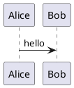
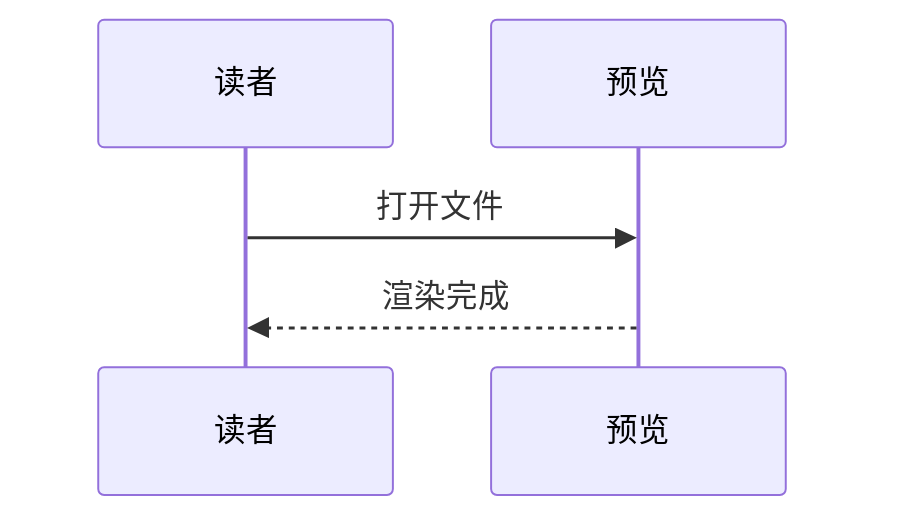

这是一份把 `etaf-md-preview` 支持的语法全部写一遍的文档。每一节给出写法，紧跟
它的渲染结果，所以打开就能对照源文件检查。默认方言是 `etaf`（最宽的那套）；
文末说明 `gfm` 与 `commonmark` 各启用哪些语法。

## 标题

一级标题用 `#`，最多六级；也可以只给文字，下一行写 `===` 或 `---`。

### 三级标题

#### 四级标题

##### 五级标题

###### 六级标题

Setext 一级标题
==============

Setext 二级标题
--------------

## 段落与换行

一个段落由空行分隔，段内换行会按软换行合并。想让这一行
强制换行，行尾留两个空格，或者用反斜杠。\
这一行就是被反斜杠断开的。

转义符让标记变成普通字符：\*不是强调\*、\`不是代码\`、\\ 是反斜杠本身。

实体写法也生效：&copy; &mdash; &amp; &lt;tag&gt;。

## 行内样式

**粗体**、*斜体*、***粗斜体***、~~删除线~~、`行内代码`。行内 HTML 按原样显示：
<kbd>Ctrl+Enter</kbd>。

行内代码里 `**这些星号不是粗体**`，反引号可以包住空格 ` a b `。

中文与 English 混排、数字 42 与符号 `$` 之间留一个空格。

## 链接

行内链接：[ETAF 仓库](https://github.com/emacs-taf/etaf)，带标题的链接：
[Ebox 渲染器](https://github.com/emacs-taf/ebox "Ebox 的排版引擎")。

引用式链接：[规范][commonmark]、[折叠式][]、[快捷式]。自动链接：
<https://etaf.top> 与裸地址 https://github.com/emacs-taf/etaf-ui ，邮箱
<mail@example.com> 也能识别。

[commonmark]: https://spec.commonmark.org "CommonMark 规范"
[折叠式]: https://github.github.com/gfm/
[快捷式]: https://etaf.top

## 图片

本地图片渲染成卡片，按 RET 用系统程序打开：


远程图片画出占位卡片，激活后在浏览器打开：


图片也可以只有替代文字：。

## 列表

无序列表：

- 第一项
- 第二项
  - 嵌套一层
    - 再嵌套一层
- 第三项

有序列表从任意数字开始：

3. 从三开始
4. 继续
   1. 嵌套有序
   2. 同层继续
5. 回到外层

任务列表用方框表示状态：

- [x] 解析器
- [x] 渲染器
- [ ] 图与公式
  - [x] Mermaid
  - [ ] PlantUML

列表项里可以放段落与代码：

- 第一段文字。

  同一项的第二个段落，缩进与标记对齐。

  ```elisp
  (message "列表里的代码块")
  ```

## 引用

> 普通引用。引用里的文字颜色淡一档，链接与代码保持自己的颜色。
>
> > 引用可以嵌套，第二层再淡一档。
>
> - 引用里可以放列表
> - 第二项
>
> ```sh
> echo "引用里的代码块"
> ```

## 代码块

围栏代码块带语言名时，用那个语言自己的 `font-lock` 着色：

```elisp
(defun greet (name)
  "Say hello to NAME."
  (message "hello %s" name)) ; 注释
```

```python
def add(a, b):
    return a + b  # 求和
```

```sh
grep -i "needle" file.txt | wc -l
```

不写语言的围栏与缩进代码块只画一种颜色：

```
普通代码，没有语言
```

    这是缩进四个空格写成的代码块
    (indented code block)

不认识的围栏语言保持源码，不报错：



## 表格

表格用竖线分列，第二行用冒号声明对齐：

| 语法 | 启用 | 说明 |
| :--- | :--: | ---: |
| 定义列表 | 是 | 术语加定义 |
| 上下标 | 是 | Unicode 字符 |
| 公式 | 是 | 纯文本或图 |
| 很长的中文单元格会按列宽折行，短词保持完整 | 是 | 右对齐 |

单元格里可以有 `代码`、**粗体** 与 [链接](https://etaf.top)。

## 分隔线

三条横线、星号或下划线都行：

---

***

___

## 提示块

> [!NOTE]
> 一般性的补充说明。

> [!TIP]
> 更省事的做法。

> [!IMPORTANT]
> 读之前必须知道的事。

> [!WARNING]
> 会出问题的地方。

> [!CAUTION]
> 可能造成损失的操作。

## 脚注

正文里点一下脚注引用[^spec]，跳到底部的定义；再一个[^dup]用来说明重复定义。

[^spec]: CommonMark 规范定义核心语法，GFM 在其上增加扩展。
[^dup]: 这个标签第一次定义的内容生效。
[^dup]: 第二次定义忽略，避免同号出现两条。

## 定义列表

定义列表用术语行加 `:` 或 `~` 开头的行为定义：

编解码器
: 把文本写进帧的工具，说明里可以放代码：

      (encode "text" coding-system)

: 也可以放列表：

  - 第一步：读
  - 第二步：写

**加粗术语**
~ 用 `~` 当标记也能起一条定义，效果与 `:` 相同。

多个术语可以共用一个定义：

Term A
Term B
: 两个术语共享这一条定义。

## 上下标

水是 H~2~O，能量是 E = mc^2^，面积单位 m^2^，化学式 CO~2~。

上下标只支持 Unicode 里有的字符，`H~2~O` 能排，`x~abc~` 这种没有对应字符的
写法保持原样。

## 缩写

用一行定义把缩写与全称绑起来，正文里整词出现时显示提示：

*[HTML]: HyperText Markup Language
*[CSS]: Cascading Style Sheets

HTML 与 CSS 是网页的两块基石；HTML5 与 CSS3 不是这两个词，所以不加提示。

## 数学

行内公式用单个美元符：$\frac{a}{b}$、$\sqrt{x}$、$a^2 + b^2 = c^2$。

价格不会被当成公式：$5、$5.00、$99.9 都还是钱。

显示公式用两个美元符，单独成块并居中排版：

$$
\sum_{i=1}^{n} i = \frac{n(n+1)}{2}
$$

$$
\int_{0}^{\infty} e^{-x^2} \, dx = \frac{\sqrt{\pi}}{2}
$$

装了 mermaid-cli 时显示公式排成图；没装时用 Unicode 近似，读得出意思。

## 表情短码

启动成功 :tada:，上线 :rocket:，注意 :warning:，修复 :bug:，笔记 :memo:。

时间 12:30:45 不是短码，未知的 :notanemoji: 也保持原样。

## 图

装了 mermaid-cli 时，`mermaid` 围栏画成图；没装时显示源码。




## HTML 块

HTML 注释不显示，但会占位：

<!-- 这一段注释不会出现在页面上 -->

<details>
<summary>折叠块在源码里是普通 HTML，页面上显示为代码</summary>
HTML 块按原样显示，不解析其中的标记。
</details>

## 方言

同一份解析器，三套预设：

- `commonmark`：只认 CommonMark 核心语法；表格、任务列表、删除线、脚注、提示块
  之外的写法都按普通文字显示。
- `gfm`：在核心之上加表格、任务列表、删除线、裸地址、脚注、提示块与 front matter。
- `etaf`（默认）：在 `gfm` 之上再加定义列表、上下标、缩写、`$` 公式与表情短码。

在这份文件的开头写一行 `flavor: commonmark`，预览就只按核心语法解析；会话参数
`:flavor` 优先于文档里的声明，文档里的声明优先于全局变量
`etaf-md-preview-flavor`。

未启用的语法不会报错，只是照原样显示：这是「一份解析器、多套开关」的退化方式。
