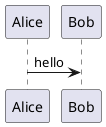
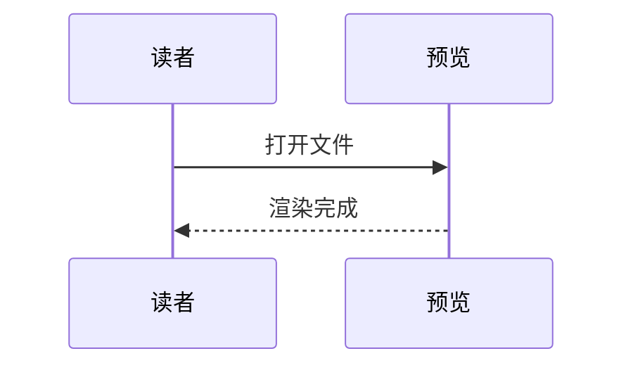
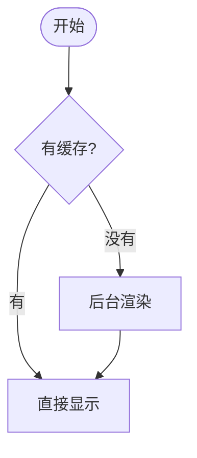

这份文档把 `etaf-md-preview` 支持的语法逐条写一遍，按类别组织，每一条都给出写法，
紧跟它的渲染结果。左边是源码，右边是页面，打开就能对照检查；改动渲染器之后，先
看这里有没有退化。

## 标题

一级标题用 `#`，最多六级。下面依次是一级到六级：

# 一级标题

## 二级标题

### 三级标题

#### 四级标题

##### 五级标题

###### 六级标题

也可以只给文字，下一行写 `===` 或 `---`，这就是 Setext 写法，只分两级：

Setext 一级标题
==============

Setext 二级标题
--------------

标题里可以放行内样式与链接：`代码`、**粗体**、*斜体* 与 [ETAF](https://etaf.top)。

## 标题锚点

标题带自动生成的锚点，同一份文档里重复的标题会追加序号：

## 重复的标题

## 重复的标题

## 段落与换行

一个段落由空行分隔，段内的换行会按软换行合并成同一段，但每一行仍然占一行，
因为页面与源码逐行对齐：

这一段的第一行
第二行接着上一行
第三行也属于同一段

想让这一行强制换行，行尾留两个空格，  
这一行就是被两个空格断开的。

也可以用一个反斜杠达到同样效果：\
这一行跟在反斜杠后面。

很长的段落用来检查折行：中文在这里连续写下去，一行放不下的时候应当在阅读栏的
宽度里折行，折行不丢字，也不把标点挤到下一行的行首，更不把整段压成一行。

中文与 English 混排、数字 42 与符号 `$` 之间要留一个空格，读起来才不挤。

## 转义与实体

反斜杠让标记变成普通字符：\*不是强调\*、\`不是代码\`、\# 不是标题、\[ 不是链接、
\\ 是反斜杠本身。

命名实体、十进制与十六进制都生效：&copy; &mdash; &amp; &lt;tag&gt; &#65; &#x41;。

行内的 HTML 按原样显示：<kbd>Ctrl+Enter</kbd>、<sub>下标</sub>、<sup>上标</sup>。

## 行内样式

**粗体**、*斜体*、***粗斜体***、~~删除线~~、`行内代码`。

风格可以嵌套：**粗体里有 *斜体* 与 `代码`**，*斜体里有 **粗体***。

词内的下划线不算强调，所以 snake_case_name 与 __init__ 保持原样。

没有配对的标记不解析：这是一个 * 号，这里是两个 ** 号。

行内代码里的标记不解析：`**这些星号不是粗体**`；反引号可以包住空格：` a b `。

行内代码也能用双反引号包住一个反引号：``a ` b``。

## 链接

行内链接：[ETAF 仓库](https://github.com/emacs-taf/etaf)。

带标题的链接，鼠标停在上面能看到标题：[Ebox 渲染器](https://github.com/emacs-taf/ebox "Ebox 的排版引擎")。

引用式链接：[规范][commonmark]、折叠式 [折叠式][]、快捷式 [快捷式]。

自动链接：<https://etaf.top> 与裸地址 https://github.com/emacs-taf/etaf-ui 。

邮箱地址也能识别：<mail@example.com>。

链接里的文字可以带样式：**[粗体链接](https://etaf.top)** 与 [`代码链接`](https://etaf.top)。

本页内的锚点链接：[回到标题](#标题)。

定义式链接的地址写在这里，页面不显示这一行：

[commonmark]: https://spec.commonmark.org "CommonMark 规范"
[折叠式]: https://github.github.com/gfm/
[快捷式]: https://etaf.top

## 图片

本地图片渲染成卡片，按 `RET` 用系统程序打开：


远程图片画出占位卡片，激活后在浏览器里打开：


图片也可以只有替代文字，文件不存在时显示替代文字：


引用式图片：![引用式图片][shot]

[shot]: etaf-md-preview-media.png "引用式定义"

## 列表

无序列表三种标记都能用：

- 连字符
* 星号
+ 加号

有序列表从任意数字开始，`1.` 与 `1)` 两种分隔符都认：

3. 从三开始
4. 继续
5. 结束

1) 圆括号一
2) 圆括号二

嵌套可以多层，标记与缩进要对齐：

- 第一层
  - 第二层
    - 第三层
      - 第四层
- 回到第一层

有序与无序可以混着嵌套：

1. 第一步
   - 细节一
   - 细节二
2. 第二步

紧凑列表的项目之间没有空行，渲染成连续的条目：

- 紧凑一
- 紧凑二
- 紧凑三

松散列表的项目之间有段落，条目之间就多一行：

- 松散一

- 松散二

- 松散三

任务列表三种状态都有：

- [x] 已完成
- [X] 大写也算完成
- [ ] 未完成

列表项里可以放段落与代码块：

- 第一段文字。

  同一项的第二个段落，缩进与标记对齐。

  ```elisp
  (message "列表里的代码块")
  ```

列表项里可以放引用与表格：

- 引用如下：

  > 列表项里的引用。

- 表格如下：

  | 键 | 值 |
  | --- | --- |
  | a | 1 |

空条目也占一行：

-
- 后面的条目

## 引用

普通引用，文字颜色淡一档，链接与代码保持自己的颜色：

> 普通引用。引用里的文字颜色淡一档，链接与代码保持自己的颜色。

引用里可以有多个段落，用一个只有 `>` 的行分开：

> 第一个段落。
>
> 第二个段落。

引用可以嵌套，第二层再淡一档：

> 外层引用
>
> > 内层引用
> >
> > > 第三层

引用里可以放标题、列表、代码块与表格：

> ## 引用里的标题
>
> - 引用里可以放列表
> - 第二项
>
> ```sh
> echo "引用里的代码块"
> ```
>
> | 键 | 值 |
> | --- | --- |
> | a | 1 |

## 提示块

五种提示块都用 `> [!类型]` 开头：

> [!NOTE]
> 一般性的补充说明。

> [!TIP]
> 更省事的做法。

> [!IMPORTANT]
> 读之前必须知道的事。

> [!WARNING]
> 会出问题的地方。

> [!CAUTION]
> 可能造成损失的操作。

## 代码块

围栏代码块带语言名时，用那个语言自己的 `font-lock` 着色：

```elisp
(defun greet (name)
  "Say hello to NAME."
  (message "hello %s" name)) ; 注释
```

```python
def add(a, b):
    return a + b  # 求和
```

```sh
grep -i "needle" file.txt | wc -l
```

```js
const answer = items.filter((item) => item.done).length
```

不写语言的围栏只画一种颜色：

```
普通代码，没有语言
```

语言名后面可以跟额外信息，页面只认语言名：

```elisp title="示例"
(message "信息串里的其它词被忽略")
```

波浪线也能围栏：

~~~ruby
puts "tilde fence"
~~~

四个反引号可以包住三个反引号：

````
```
inner fence
```
````

不认识的围栏语言保持源码，不报错：



缩进四个空格也写成代码块：

    这是缩进四个空格写成的代码块
    (indented code block)

代码块里的空行原样保留：

```text
第一行

第三行
```

## 表格

左对齐：

| 语法 | 说明 |
| :--- | :--- |
| 定义列表 | 术语加定义 |
| 上下标 | Unicode 字符 |

右对齐：

| 语法 | 说明 |
| ---: | ---: |
| 定义列表 | 术语加定义 |
| 上下标 | Unicode 字符 |

居中对齐：

| 语法 | 说明 |
| :--: | :--: |
| 定义列表 | 术语加定义 |
| 上下标 | Unicode 字符 |

三种对齐在一张表里对比：

| 左 | 中 | 右 |
| :--- | :--: | ---: |
| 短 | 短 | 短 |
| 长一点的文字 | 长一点的文字 | 长一点的文字 |

单元格里可以有 `代码`、**粗体** 与 [链接](https://etaf.top)：

| 内容 | 写法 |
| --- | --- |
| `代码` | 反引号 |
| **粗体** | 星号 |
| [链接](https://etaf.top) | 方括号加圆括号 |

竖线要转义才能放进单元格：`a \| b` 写成 `a \| b`。

| 表达式 | 结果 |
| --- | --- |
| a \| b | 逻辑或 |
| c \| d | 也是逻辑或 |

空单元格与不齐的行也能渲染：

| a | b | c |
| --- | --- | --- |
| 1 |  | 3 |
| 4 | 5 |

中文与 English 混排的单元格会按列宽折行，短词保持完整：

| 语法 | 说明 |
| --- | --- |
| 很长的中文单元格会把这段说明折成几行，短词不拆开 | 右侧列宽跟随内容 |
| `code` keeps together | 中英混排 |

## 分隔线

三条横线、星号或下划线都行，字符之间可以有空格：

---

***

___

- - -

* * *

## 脚注

正文里点一下脚注引用[^spec]，跳到底部的定义；第二个引用[^dup]用来说明重复定义；
同一个脚注引用两次[^spec]也只出现一条。

未定义的引用[^missing]保持原样，不会生成条目。

[^spec]: CommonMark 规范定义核心语法，GFM 在其上增加扩展。

[^dup]: 这个标签第一次定义的内容生效。

[^dup]: 第二次定义忽略，避免同号出现两条。

## 定义列表

单个术语一条定义：

编解码器
: 把文本写进帧的工具。

一个术语可以有多条定义：

渲染器
: 第一层输出，负责画格子。

: 第二条定义，说明的另一面。

多个术语可以共用一个定义：

Term A
Term B
: 两个术语共享这一条定义。

用 `~` 当标记也能起一条定义：

**加粗术语**
~ 用 `~` 当标记也能起一条定义，效果与 `:` 相同。

定义里可以放代码块：

缩进
: 说明里放代码：

      (encode "text" coding-system)

定义里可以放列表：

步骤
: 说明里放列表：

  - 第一步：读
  - 第二步：写

## 上下标

水是 H~2~O，能量是 E = mc^2^，面积单位 m^2^，化学式 CO~2~。

上下标只支持 Unicode 里有的字符，`H~2~O` 能排，`x~abc~` 这种没有对应字符的
写法保持原样。

字母与多字符混用：x~i~、a^b^、2^10^、10^-3^。

## 缩写

用一行定义把缩写与全称绑起来，正文里整词出现时显示提示：

*[HTML]: HyperText Markup Language
*[CSS]: Cascading Style Sheets

HTML 与 CSS 是网页的两块基石；HTML5 与 CSS3 不是这两个词，所以不加提示。

## 数学

行内公式用单个美元符：$\frac{a}{b}$、$\sqrt{x}$、$a^2 + b^2 = c^2$、$\alpha + \beta$。

价格不会被当成公式：$5、$5.00、$99.9 都还是钱；转义的 \$5 也是钱。

显示公式用两个美元符，单独成块并居中排版：

$$
\sum_{i=1}^{n} i = \frac{n(n+1)}{2}
$$

$$
\int_{0}^{\infty} e^{-x^2} \, dx = \frac{\sqrt{\pi}}{2}
$$

$$
\frac{\partial^2 u}{\partial t^2} = c^2 \nabla^2 u
$$

没装 mermaid-cli 时公式用 Unicode 近似，读得出意思。

## 表情短码

启动成功 :tada:，上线 :rocket:，注意 :warning:，修复 :bug:，笔记 :memo:，
爱心 :heart:，加一 :+1:。

中文紧挨着也能出图：表情：:tada:

时间 12:30:45 不是短码，未知的 :notanemoji: 也保持原样。

## 图

装了 mermaid-cli 时，`mermaid` 围栏画成图；没装时显示源码。






## HTML 块

HTML 注释不显示，但会占位：

<!-- 这一段注释不会出现在页面上 -->

<details>
<summary>折叠块在源码里是普通 HTML，页面上显示为代码</summary>
HTML 块按原样显示，不解析其中的标记。
</details>

媒体元素渲染成卡片：

<video src="missing-video.mp4"></video>


## 方言

同一份解析器，三套预设：

- `commonmark`：只认 CommonMark 核心语法；表格、任务列表、删除线、脚注、提示块
  之外的写法都按普通文字显示。
- `gfm`：在核心之上加表格、任务列表、删除线、裸地址、脚注、提示块与 front matter。
- `etaf`（默认）：在 `gfm` 之上再加定义列表、上下标、缩写、`$` 公式与表情短码。

在这份文件的开头写一行 `flavor: commonmark`，预览就只按核心语法解析；会话参数
`:flavor` 优先于文档里的声明，文档里的声明优先于全局变量
`etaf-md-preview-flavor`。

未启用的语法不会报错，只是照原样显示：这是「一份解析器、多套开关」的退化方式。
