# 图表画廊

预览把一页 Markdown 画成文字页面，图和公式都是页面的一部分：配色跟页面走，缩放时按矢量重画。
这一页是全部图表类型的样本，每种都写真实的用法和不同的参数，方便对照。

## 流程图：形状与分组

每种形状有含义：圆角是开始结束，菱形是判断，圆柱是存储，子程序是调用。
两条分支分别用 `classDef` 上了色，颜色从页面的强调色取。

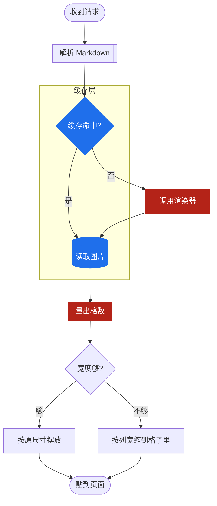

横向排布用于一条主线的流程，节点少的时候比竖排紧凑：


## 时序图：一次主题切换

`autonumber` 给消息编号；`alt`、`opt`、`loop` 表达分支与重复；`activate` 画出演进期。

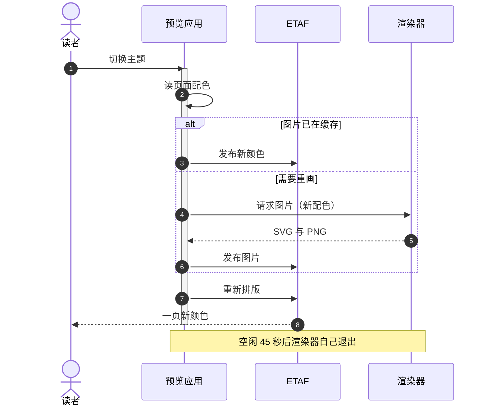

## 类图：泛型与关系

继承、组合、聚合、依赖各有一条线；`~T~` 写泛型参数，`{abstract}`、`{static}` 写在成员上。

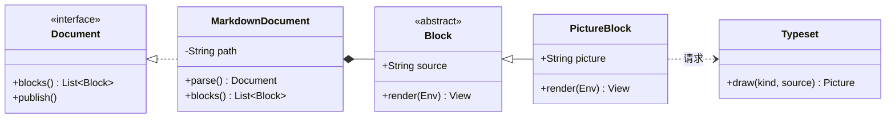

## 状态图：复合状态与分叉

`state ... as` 起别名，`<<fork>>`、`<<join>>` 画并行，`--` 分出两条同时进行的路径。

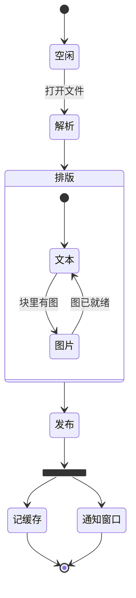

## ER 图：主键与外键

`PK`、`FK` 标出键，`||--o{` 这样的写法表示一对多，注释写在各列后面。

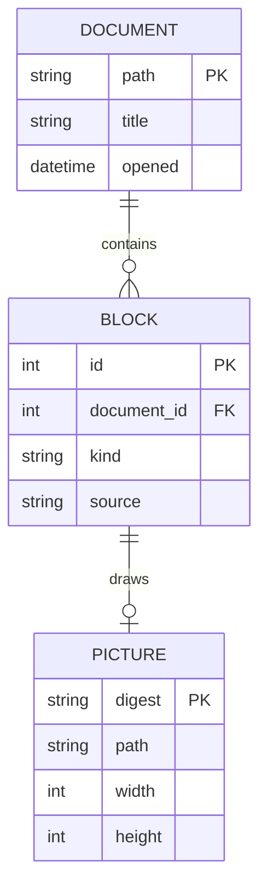

## 甘特图：里程碑与关键路径

`done`、`active`、`crit` 是任务状态；`milestone` 是零长度节点；`excludes` 跳过周末。

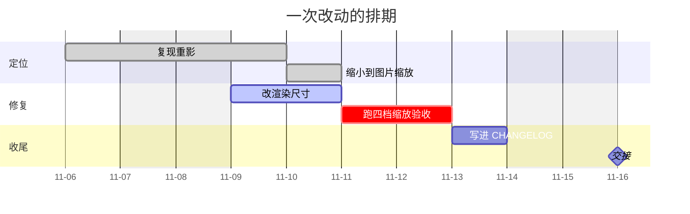

## 饼图：带数值

`showData` 把每段的数值写在标签里，适合占比一眼看明白。

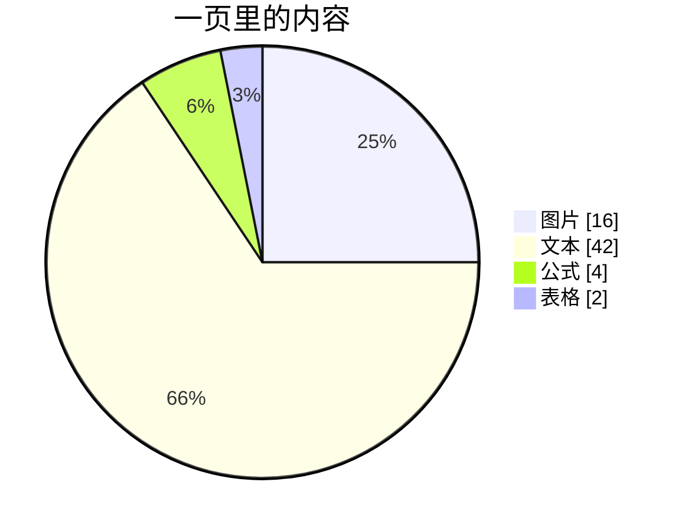

## 需求图：验证与满足

`requirement` 写需求，`element` 写实现，`satisfies`、`verifies` 连起来。

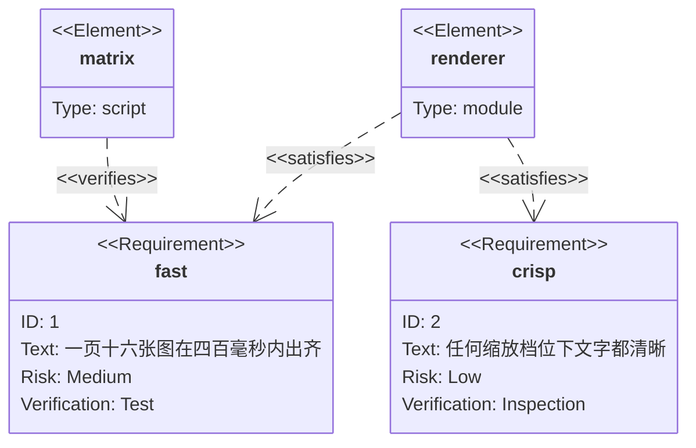

## Git 图：分支与补丁

`branch`、`checkout`、`merge`、`cherry-pick` 各画一种线；`tag` 标版本。

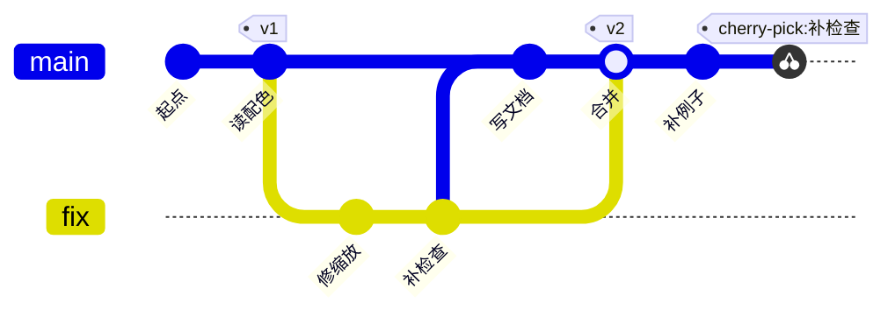

## 旅程图：一段使用过程

`section` 分区，每行是「任务: 分数: 角色」，分数决定曲线的起伏。

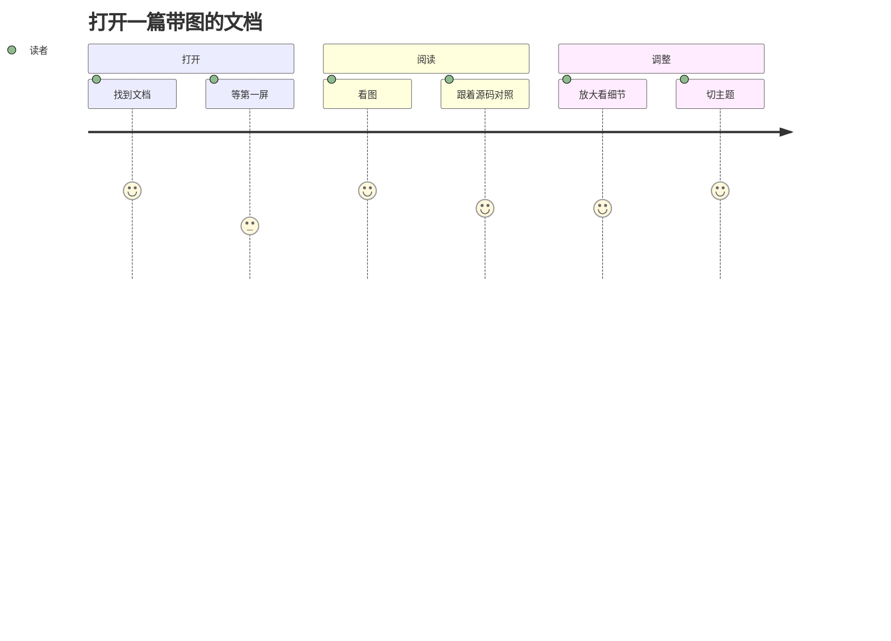

## 思维导图：形状与图标

根节点用圆形，第二层用不同形状区分职责，`::icon` 挂图标。

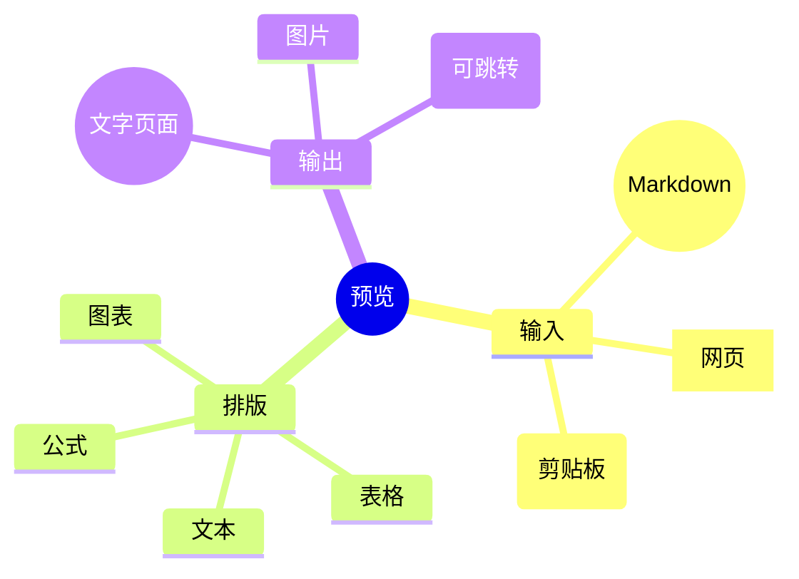

## 时间线：按年份分组

`section` 分期，`时间 : 事件 : 事件` 一行可以写多条。

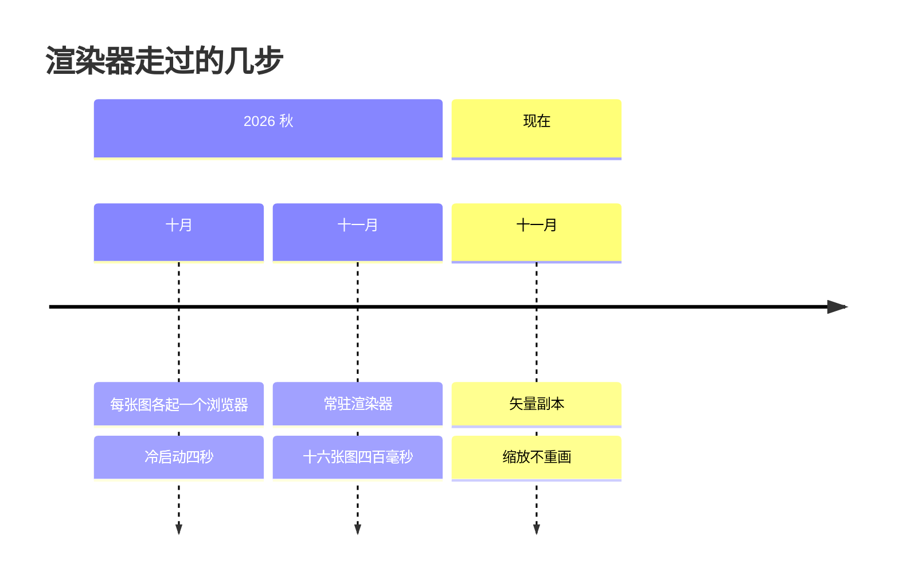

## 象限图：两个维度

`x-axis`、`y-axis` 给范围和两端名称，四个 `quadrant` 写判断，点用 `[x, y]` 定位。

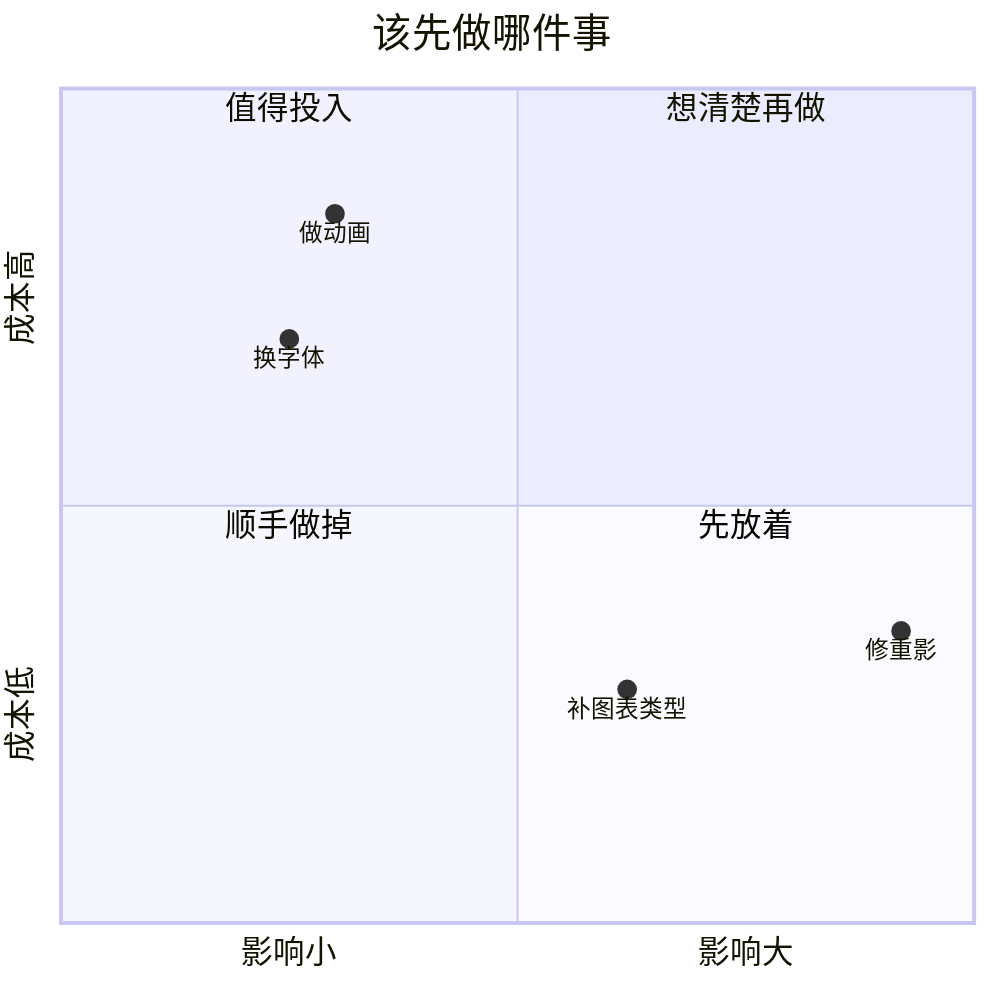

## 桑基图：能量的去向

第一列写来源，第二列写去向，第三个数是量；同一节点自动汇总。
节点名要用拉丁字母，mermaid 的桑基图只接受这种名字。

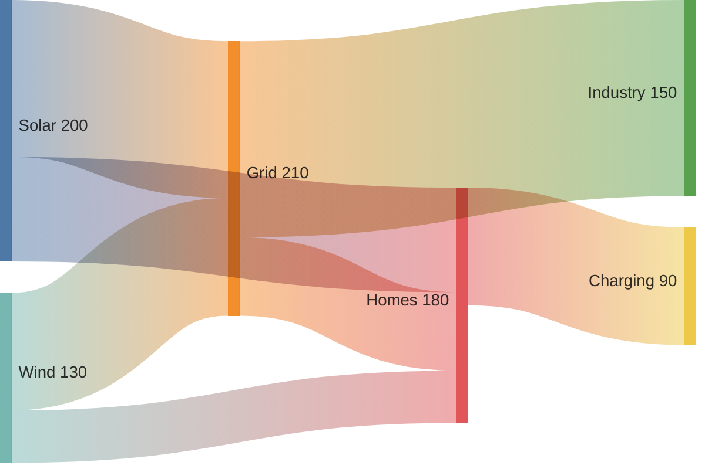

## XY 图：柱与线

柱和线是两个序列，各取一种颜色；`x-axis` 写分类，`y-axis` 写范围和单位。

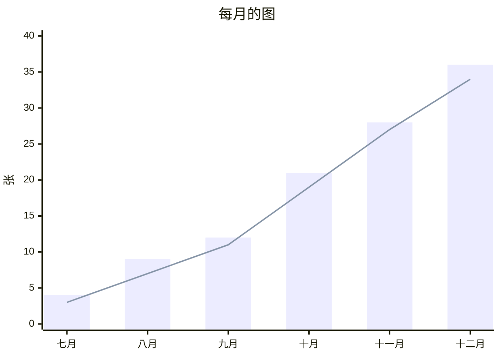

## 块图：按列摆

`columns` 定列数，`块:2` 占两列，`space` 留空，箭头画出数据流向。

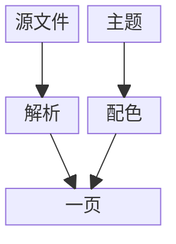

## 数据包图：字段与位宽

`起-止: "名称"` 给每个字段的位置，宽度自然就是字段的位数。

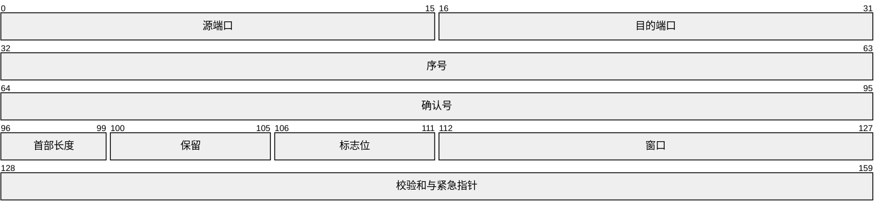

## 看板：三列状态

列名写在方括号里，卡片可以带负责人与优先级。


## 架构图：分组与服务

`group` 画边界，`service` 写服务，`in` 表示属于哪个组，`A:R -- L:B` 连两个端口。


## 雷达图：两组对比

`axis` 定维度，`curve` 给每组打分；两个序列用两种颜色，填充半透明。

```mermaid
radar-beta
  title 预览的几个方面
  axis speed["速度"], sharp["清晰"], steady["稳定"], cost["成本"]
  curve now["当前"]{9, 9, 8, 6}
  curve goal["目标"]{9, 10, 9, 8}
```

## 矩形树图：面积即数量

嵌套一层就是分组，数值决定面积，标签自动缩放。

```mermaid
treemap-beta
"一页的内容"
    "正文": 42
    "图表": 16
    "公式": 4
    "表格": 2
    "代码": 6
```

## C4：系统上下文

`Person`、`System`、`System_Ext` 画角色与系统，`Rel` 写关系，`Boundary` 圈出边界。

```mermaid
C4Context
  title 预览在系统里的位置
  Person(reader, "读者", "读文档的人")
  Boundary(app, "预览应用") {
    System(preview, "Markdown 预览", "把源码画成页面")
    System(renderer, "渲染器", "把图与公式画成图片")
  }
  System_Ext(editor, "编辑器", "改源码")
  Rel(reader, preview, "阅读")
  Rel(editor, preview, "保存后刷新")
  Rel(preview, renderer, "请求图片")
```

## 公式：行内与独立

行内公式跟着句子走，例如页面宽度按 $w = \lceil p / c \rceil$ 换算成格数，其中 $p$ 是像素宽，$c$ 是字符宽。
独立公式单独成行，居中，上下留一行空白。

$$
\text{行高} = \max_{g \in G}\bigl(\text{ascent}(g) + \text{descent}(g)\bigr)
$$

矩阵与分段函数：

$$
A = \begin{pmatrix}
a_{11} & a_{12} & a_{13} \\
a_{21} & a_{22} & a_{23} \\
a_{31} & a_{32} & a_{33}
\end{pmatrix},
\qquad
f(x) = \begin{cases}
x^2, & x \ge 0, \\
-x, & x < 0.
\end{cases}
$$

求和、极限与偏导写在一行里也不挤：

$$
\sum_{i=1}^{n} \frac{1}{i^2} = \frac{\pi^2}{6},
\qquad
\lim_{h \to 0} \frac{f(x+h) - f(x)}{h} = \frac{\partial f}{\partial x}
$$

## 表格与提示块

| 图表 | 参数 | 用在哪 |
| --- | --- | --- |
| 流程图 | `classDef`、子图 | 流程、调用链 |
| 时序图 | `autonumber`、`alt` | 交互过程 |
| 甘特图 | `done`、`crit` | 排期 |
| 象限图 | 轴范围、点坐标 | 取舍 |

> [!NOTE]
> 图里的颜色都来自页面：切到亮色、暗色或 sepia，图上每个字仍然清楚。

> [!WARNING]
> 语法错的块不会被记成永久失败，改对源码就会重新画。

## 代码、引用与清单

```elisp
(defun etaf-md-preview--typeset-grid (path max-columns)
  "Return the (COLUMNS . ROWS) grid for the picture at PATH."
  (cons (min max-columns (round (/ (car (etaf-md-preview--image-pixels path))
                                   (float (car (etaf-md-preview--cell-metrics))))))
        nil))
```

> 图片的纵向几何只有一个所有者，就是 Emacs 的排版结果。

- [x] 十几种图在三种配色下都能读
- [x] 切换缩放不重画矢量
- [ ] 图表在窄窗口里自动缩到列宽
