# 图表场景

这一页把预览支持的十四种 mermaid 图各画一遍，用的是接近真实的复杂度：多个参与者、多层结构、多种关系。源码就是围栏里的内容，改一行，图跟着变。

## 流程图

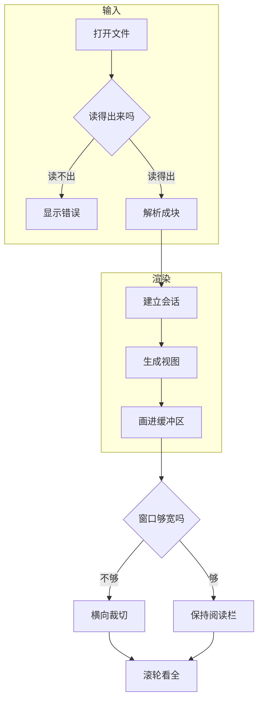

## 菱形判断

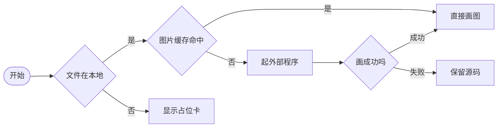

## 时序图

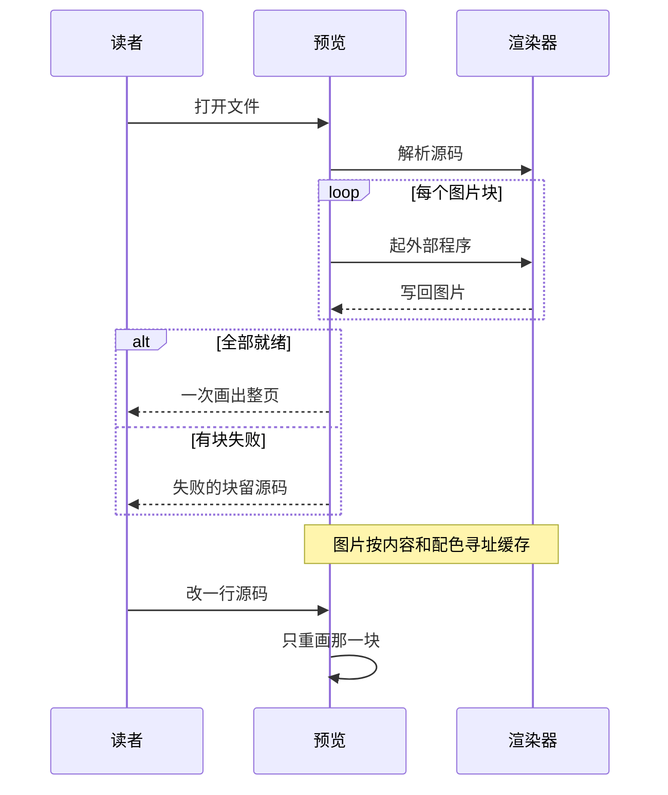

## 状态图

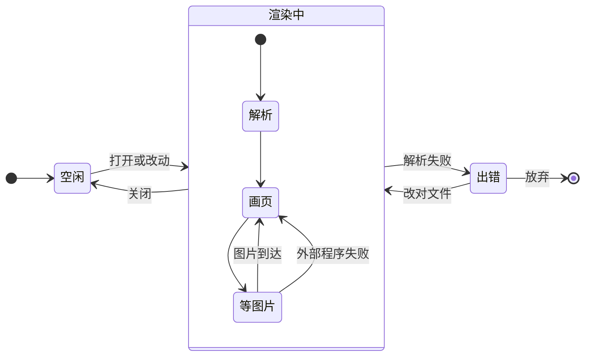

## 类图

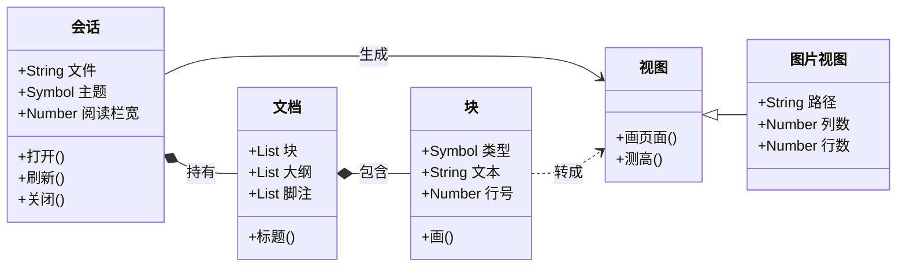

## 实体关系图

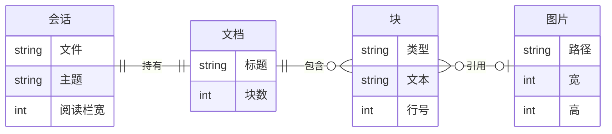

## 需求图

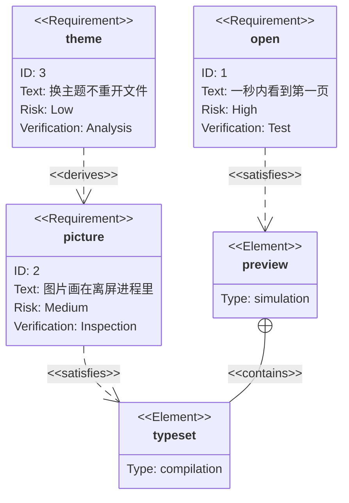

## 饼图

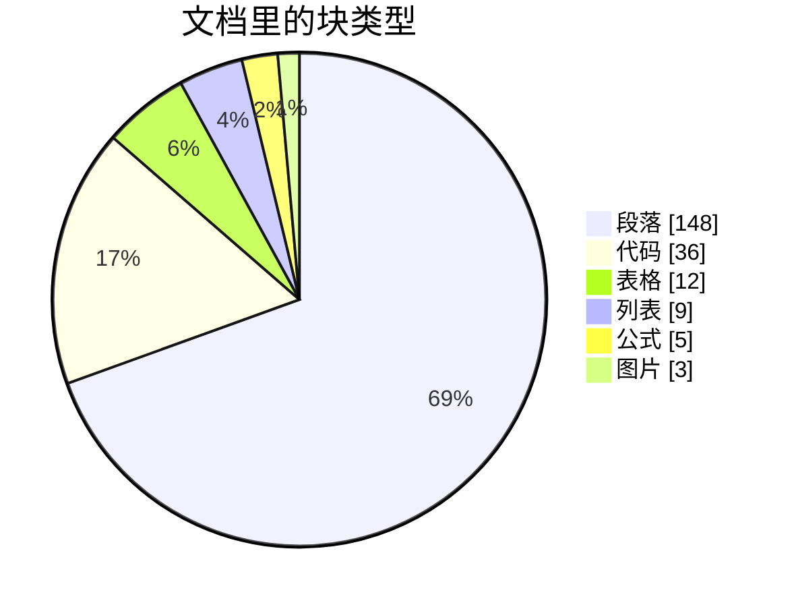

## 甘特图

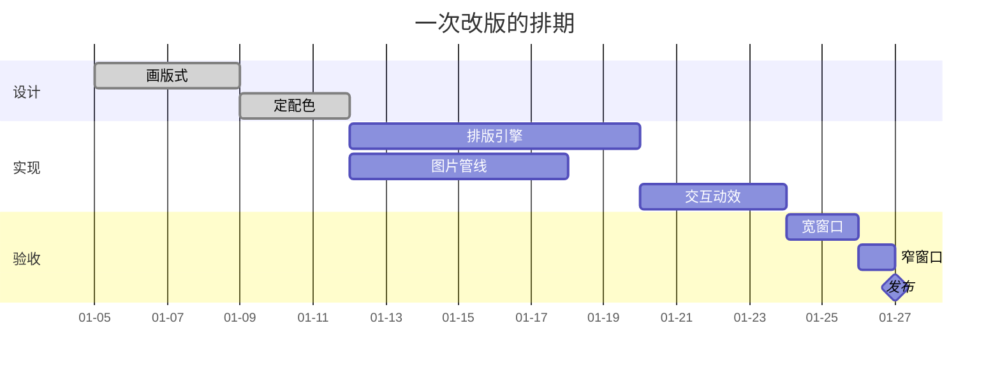

## 用户旅程图

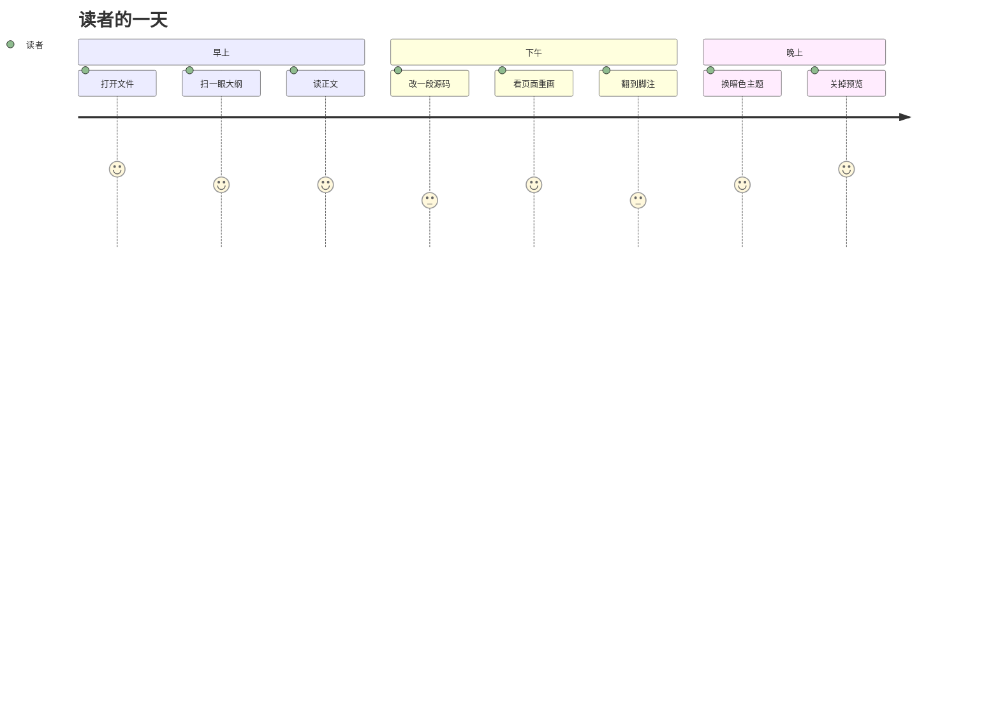

## 思维导图

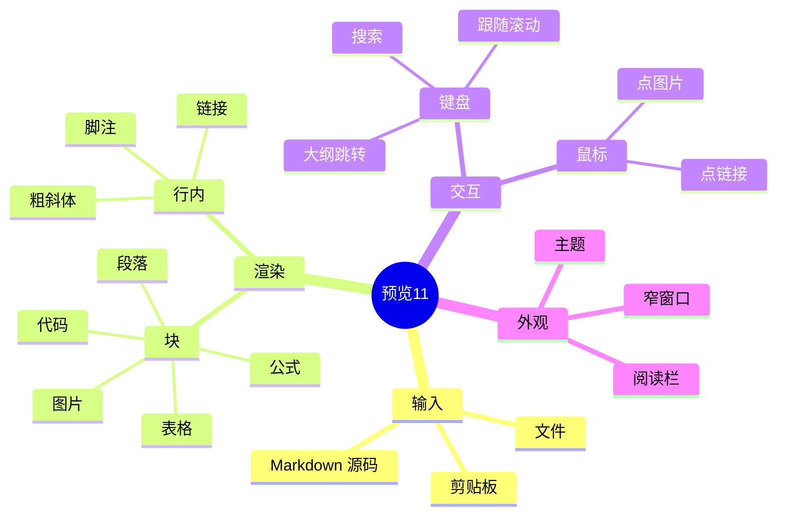

## 版本图

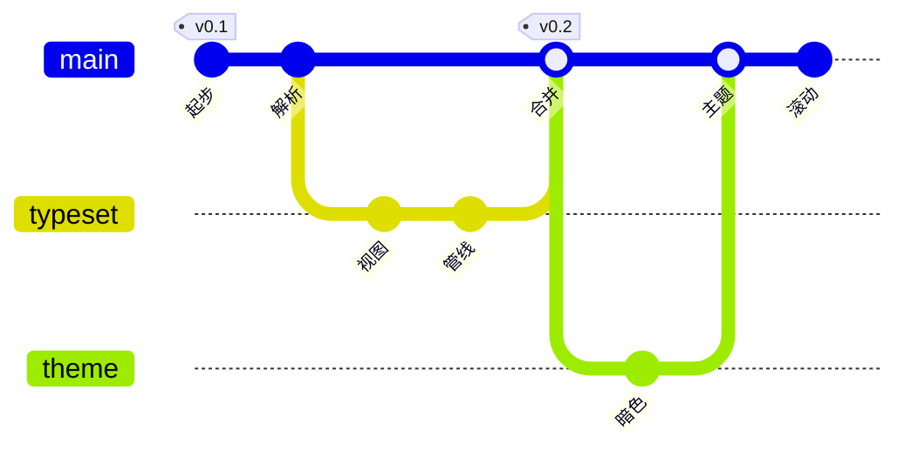

## 象限图

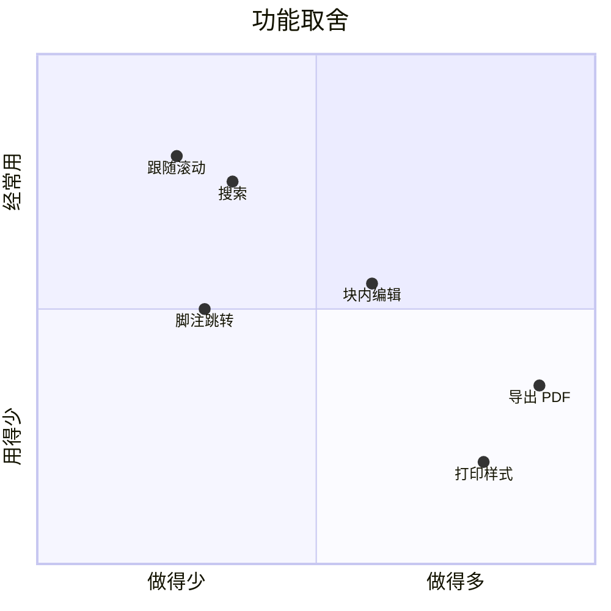

## 时间线

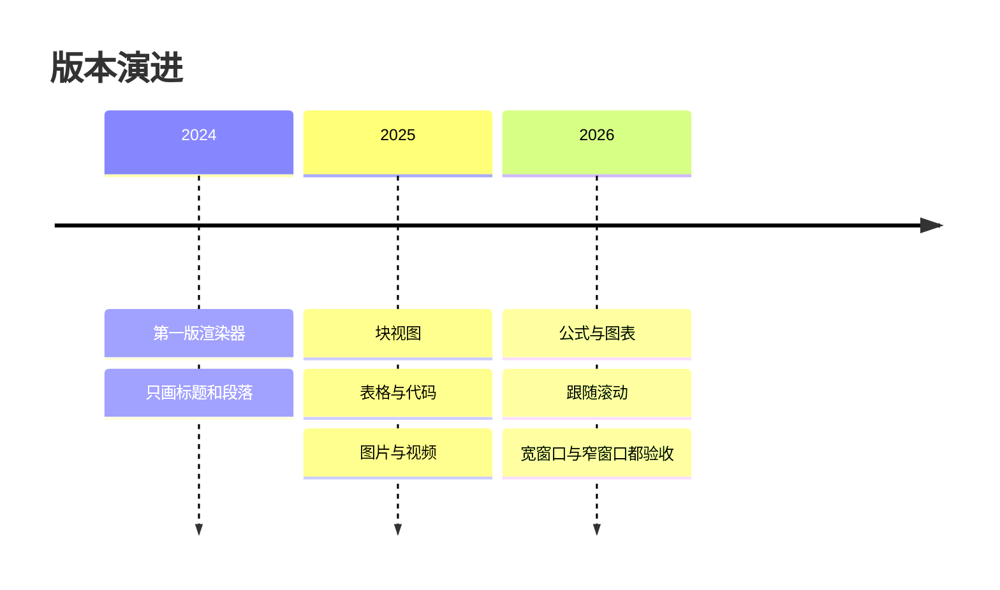

## 自定义配色

图里可以自己给颜色，用 init 指令覆盖默认配色：

写在源码开头的 front matter 也一样：

这两种写法都优先于预览自己的配色，所以一页里可以有几块不同样子的图。
