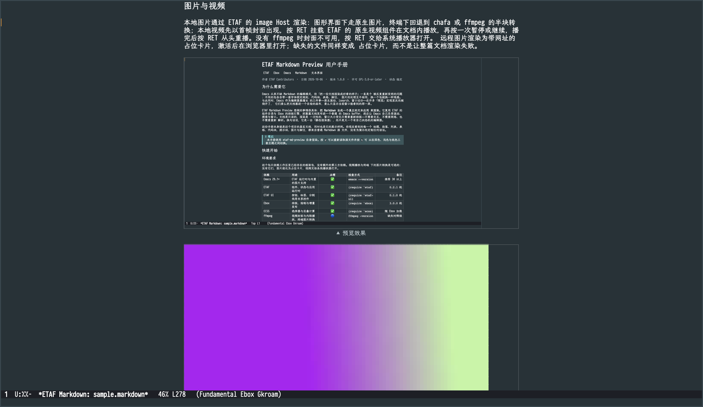

# 站点组件与行内记号

行内记号：==高亮=={.warning}，==提示=={.tip}，::check:: 图标，:kbd[Ctrl+B] 按键，:badge[v2]{.tip} 徽章，:tada: 表情。

## 站点组件

:::home-box {title="把文档当页面读" description="一个首屏大块，标题、摘要和行动链接都在这里。" href="#站点组件"}
下面的正文照常写。
:::

:::image-card {src="etaf-md-preview-media.png" title="图片卡片" description="图片在上，标题和说明在下。" href="#站点组件"}
:::

:::link-card {href="https://etaf.top/" title="ETAF 主页" description="整张卡片都可以点。"}
:::

:::npm-badge {name="etaf-md" version="0.1.0" downloads="1.2k"}
:::

:::plot {values="5.4,0.33,0.18" labels="打开,缩放,内存" max="6"}
:::

:::qrcode {text="https://etaf.top/" title="扫码打开 etaf.top"}
:::

:::swiper
@slide {title="第一张"}

@slide {title="第二张"}

:::

:::code-tree {title="示例源码"}
@file lisp/etaf-md-env.el
```elisp
(defun etaf-md-attr (env key &optional node)
  "Return KEY's final value for ENV's block."
  ...)
```
@file lisp/etaf-md-views.el
```elisp
(defun etaf-md--block-view (session key block ref widths)
  "Return the keyed Component call that renders BLOCK."
  ...)
```
:::

:::npm-to
```sh
npm install -D etaf-md
```
:::
