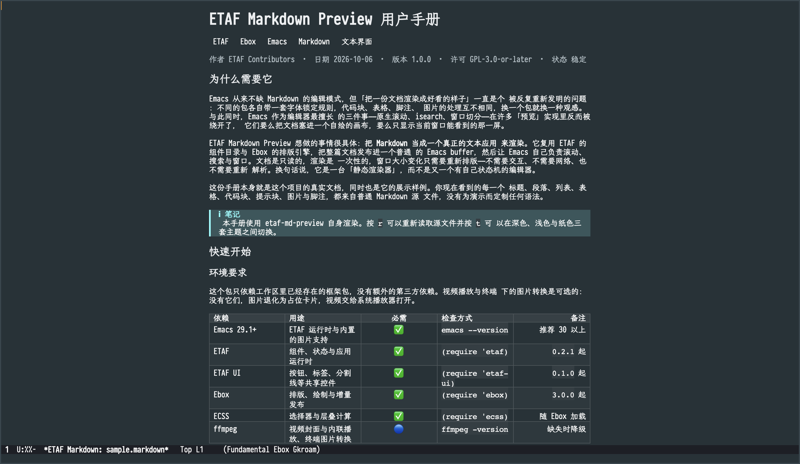

# 站点组件与行内记号

这一页把站点组件的每种写法都摆一遍：同一个组件的不同参数、参数省略后的样子，以及行内记号的四种类型和配色。

## 行内记号

四种记号在同一句里：==高亮==、::check:: 图标、:kbd[Ctrl+B] 按键、:badge[v2]{.tip} 徽章，再加一个表情 :tada:。

配色各来一遍：==警告=={.warning}、==危险=={.danger}、==成功=={.success}、==提示=={.tip}、==信息=={.info}。

按键的三种写法：:kbd[Esc]、:kbd[Ctrl+Shift+P]、:kbd[Cmd+K]。

图标：::check::、::close::、::bell-off::、::search::。

徽章：:badge[稳定]{.success}、:badge[实验]{.warning}、:badge[废弃]{.danger}、:badge[新]{.info}。

## 首屏

:::home-box {title="把文档当页面读" description="一个首屏大块：强调标题、摘要、行动链接和正文都在里面。" href="https://etaf.top/"}
首屏里的正文照常写，列表、代码和链接都能放。
:::

:::home-box {title="只有标题的首屏"}
标题以外的参数都省略时，只剩标题和正文。
:::

:::home-box {title="换一种强调色" description="accent 可以取 success、warning、danger、important 或 neutral。" accent="success" background="sunken"}
底色同样可以换。
:::

## 字段

一个参数的说明卡：名字一行，状态徽标跟在后面，类型、默认值和引入版本一行，正文就是说明。

:::field {name="text" type="string" default="空字符串" required=true since="0.1"}
要画成链接的文字，必填。
:::

:::field {name="width" type="number" default="46" unit="列" constraint="8 ≤ width ≤ 120" enum="8 | 16 | 46 | 120" format="整数"}
图片卡的最大列数，超出页面宽度时自动收窄。
:::

:::field {name="tabs" type="string" enum="npm | pnpm | yarn | bun | deno" deprecated="0.2" experimental="1.0"}
要显示的包管理器，逗号分隔；第二个参数已弃用，第四个还在试验。
:::

:::field {name="type-link" type="string" type-link="https://etaf.top/" since="0.3"}
类型名可以是一个链接，点它打开目标页。
:::

:::field
- 版本：12.3.0
- 渲染器：Chromium，常驻
- 缓存：`~/.cache/etaf-md/typeset`
:::

## 图片卡片

:::image-card {src="etaf-md-preview-wide.png" title="完整的预览" description="图片在上，标题和说明在下；整张卡片都能点。" href="https://etaf.top/"}
:::

:::image-card {src="etaf-md-preview-media.png" title="只有标题" width="40"}
:::

:::image-card {src="../tests/fixtures/wide-400x100.png" width="52"}
:::

## 卡片网格

:::columns {columns=2}
:::col
:::image-card {src="etaf-md-preview-wide.png" title="网格里的第一张" width="38"}
:::
:::
:::col
:::image-card {src="etaf-md-preview-media.png" title="网格里的第二张" width="38"}
:::
:::
:::

:::columns {columns=2}
:::col
:::link-card {href="https://etaf.top/" title="两张卡片并排" description="每一栏各放一张，卡片自己负责边界和底色。"}
:::
:::
:::col
:::link-card {href="https://github.com/emacs-taf" title="右栏的链接" description="link-card 在栏里自动铺满可用宽度。"}
:::
:::
:::

## 弹性布局

Plume 的 `flex` 和 `card-grid` 在这套语法里都是 `columns`：数字是等宽几栏，一串轨道是按比例或固定宽分栏，`wrap`、`gap`、`justify-content` 与它同名同义。

:::columns {columns=3 gap="2ch" divider=false}
:::col
:::card {title="等宽一" description="三栏等宽。"}
:::
:::
:::col
:::card {title="等宽二" description="三栏等宽。"}
:::
:::
:::col
:::card {title="等宽三" description="三栏等宽。"}
:::
:::
:::

:::columns {columns="22ch 22ch 22ch" gap="3ch" wrap=true divider=false}
:::col
:::card {title="固定宽一"}
:::
:::
:::col
:::card {title="固定宽二"}
:::
:::
:::col
:::card {title="固定宽三"}
:::
:::
:::col
:::card {title="换行的第四张"}
:::
:::
:::

## 提示块

八个名字共用同一个视图，只是强调色和固定标题不同。

:::note {title="Note 是默认标题"}
标题可以覆盖。
:::

:::info
info 与 note 同色，名字不同。
:::

:::tip {title="提示"}
成功色。
:::

:::important
重要色。
:::

:::warning
警告色。
:::

:::caution
注意色。
:::

:::danger {title="危险"}
危险色。
:::

:::note {collapsible=true title="可收起的提示"}
点标题收起或展开。
:::

## 对齐

:::center
这一行居中。
:::

:::right
这一行靠右。
:::

:::justify
两端对齐适合较长的说明文字。它会把每一行的两端都排齐，只在最后一行留出自然的空隙，读起来像排过版的正文而不是随手写的段落。
:::

## 折叠与详情

:::details {title="默认收起的一块"}
这里的正文只在展开后出现。
:::

:::details {title="默认展开的一块" open=true}
打开页面时就能看到这段正文。
:::

:::accordion
:::collapse {title="第二块"}
这里同时只开一块。
:::
:::collapse {title="第一块" index=1 open=true}
`index` 决定显示顺序。
:::
:::

:::accordion {accordion=false}
:::collapse {title="可以同时打开的一"}
:::
:::collapse {title="可以同时打开的二" open=true}
这一块默认就展开，可以和上面那块一起开着。
:::
:::

## 卡片图标与窗口

:::columns {columns=2 divider=false}
:::col
:::card {title="带图标的卡片" icon="check" description="图标跟标题在同一行。"}
卡片正文。
:::
:::
:::col
:::card {title="没有图标的卡片" description="默认什么都不画。"}
:::
:::
:::

:::window {title="带间距的窗口" gap="1lh" height="6lh"}
窗口内容区可以定高，`gap` 在标题栏下留一行。
:::

:::window {title="不留内边距" no-padding=true height="4lh"}
`no-padding` 让内容贴着边框。
:::

## 链接卡片

:::link-card {href="https://etaf.top/" title="ETAF 主页" description="整张卡片都可以点，箭头下面是目标地址。"}
:::

:::link-card {href="https://github.com/emacs-taf" title="只有标题和地址"}
:::

## npm 徽章

:::npm-badge {name="etaf-md" version="0.1.0" downloads="1.2k"}
:::

:::npm-badge {name="etaf-ui"}
:::

:::npm-badge {name="etaf" version="0.9.2"}
:::

## 二维码

:::qrcode {text="https://etaf.top/" title="扫码打开 etaf.top"}
:::

:::qrcode {text="ETAF 把文档当页面读"}
:::

:::qrcode {text="https://github.com/emacs-taf/etaf-md/blob/main/docs/extensions.zh-CN.md" title="长一点的地址也能装下"}
:::

## 轮播

:::swiper
@slide {title="宽图"}

@slide {title="第二张"}
第二页是文字，轮播不只能放图片。
@slide {title="第三张"}

:::

:::swiper
@slide

@slide {selected=true}
第二页默认打开。
:::

## 源码树

:::code-tree {height=20}
@file Makefile
```make
.DEFAULT_GOAL := check
.NOTPARALLEL:
EMACS ?= emacs
# Providers are siblings in the workspace and in a standalone clone;
# override PROVIDER_ROOT to pin another checkout.
PROVIDER_ROOT ?= ..
LOAD_PATH = -L . -L lisp -L tests -L $(PROVIDER_ROOT)/etaf -L $(PROVIDER_ROOT)/etaf-ui -L $(PROVIDER_ROOT)/ebox -L $(PROVIDER_ROOT)/ecss
SOURCES = $(wildcard lisp/*.el)
SOURCES += etaf-md.el
SOURCES += $(wildcard examples/*.el)
SOURCES += scripts/etaf-md-gui-probe.el
SOURCES += benchmarks/performance-scenarios.el

.PHONY: compile load check clean structure-check setup-hooks acceptance api-check test benchmark mermaid-check

compile:
	rm -f *.elc lisp/*.elc tests/*.elc examples/*.elc scripts/*.elc
	$(EMACS) -Q --batch $(LOAD_PATH) \
		--eval '(setq load-prefer-newer t byte-compile-error-on-warn t)' \
		--eval '(require (quote cl-lib))' \
		--eval '(unless (cl-every (function byte-compile-file) (quote ($(foreach file,$(SOURCES),"$(file)")))) (kill-emacs 1))'

load: compile
	$(EMACS) -Q --batch $(LOAD_PATH) --eval '(require (quote etaf-md))' --eval '(princ "etaf-md load OK\n")'

check: structure-check compile acceptance api-check
```
@file lisp/etaf-md-env.el
```elisp
(defun etaf-md--paint (node env)
  "Return the view ENV's definition gives NODE, or a failure line."
  (let* ((type (etaf-md-node-type node))
         (definition (etaf-md-node-definition type))
         (problems (and definition (plist-get definition :view)
                        (etaf-md--all-problems node))))
    (cond
     (problems
      (etaf-md--failure-view
       env (or (etaf-md-node-source node) "") (cadr (car problems))))
     ((and definition (plist-get definition :view))
      (let ((inner (etaf-md-env-create
                    :session (etaf-md-env-session env)
                    :node node
                    :width (etaf-md-env-width env)
                    :state (etaf-md-env-state env)
                    :palette (etaf-md-env-palette env)
                    :theme (etaf-md-env-theme env)
                    :block (etaf-md-node-block node))))
        (funcall (plist-get definition :view) inner)))
     ;; A Markdown block the new model does not define yet keeps the painter
     ;; it has today; only a container with no definition is a failure,
     ;; because a container cannot be painted without one.
     ((and (etaf-md-node-block node)
           (not (eq (plist-get (etaf-md-node-block node) :type) 'container)))
      (etaf-ui-markdown-view-block
       (etaf-md-node-block node)
       ;; A block painted below a container keeps the page services: media,
```
@file lisp/etaf-md-views.el
```elisp
    (warning . "警告") (caution . "小心"))
  "Chinese labels of the GitHub alert kinds, for ENV's `:alert-labels'.")

(defconst etaf-md--video-extensions
  '("mp4" "mov" "m4v" "webm" "avi" "mkv" "ogv" "mpg" "mpeg" "wmv" "flv" "3gp")
  "File extensions rendered as a video card.")

(defun etaf-md--env-color (env key)
  "Return ENV's color for semantic KEY.
ENV's face-derived `:palette', when present, wins over the named theme; an
unknown key in either source signals `etaf-md-error'."
  (if-let* ((palette (plist-get env :palette)))
      (or (cdr (assq key palette))
          (signal 'etaf-md-error
                  (list (format "Unknown markdown preview color: %S" key))))
    (etaf-md-color key (plist-get env :theme))))

(defconst etaf-md--meta-labels
  '(("author" . "作者") ("date" . "日期") ("version" . "版本")
    ("license" . "许可") ("status" . "状态"))
  "Front matter keys shown in the document header, with their labels.")

(defun etaf-md--meta-tags (meta)
  "Return the tag list of front matter META.
Both `[a, b]' and `a, b' spellings are accepted."
  (let ((raw (cdr (assoc "tags" meta))))
    (when (and raw (not (string-empty-p raw)))
      (let ((raw (replace-regexp-in-string "[][]" "" raw)))
```
@file lisp/etaf-md-nodes.el
```elisp
    (open              :type boolean :default t   :doc "收起时默认展开")
    (background        :type surface :default quote :doc "底色")
    (border-left-width :type length :default "1ch" :doc "左侧竖条宽度"))
  "Attributes every callout name shares.")

(defun etaf-md--toggle-line (label color command)
  "Return LABEL painted in COLOR as a focusable disclosure line.
COMMAND runs when the line is activated."
  (etaf-node 'box
             (list :color color :font-weight 'bold :on-press command)
             (list (etaf-node 'text nil (list label)))))

(defun etaf-md--callout-open-p (env)
  "Return non-nil when ENV's callout shows its body."
  (if (etaf-md-attr env :collapsible)
      (etaf-md-block-state env :open (etaf-md-attr env :open))
    t))

(defun etaf-md--callout-view (env)
  "Paint a callout; the five names share this view."
  (let* ((accent (etaf-md--callout-accent (etaf-md-type env)))
         (title (or (etaf-md-attr env :title)
                    (alist-get (etaf-md-type env) etaf-md--callout-titles)))
         (open (etaf-md--callout-open-p env))
         (collapsible (etaf-md-attr env :collapsible)))
    (etaf-node
```
@file tests/etaf-md-tests.el
```elisp
;;; etaf-md-tests.el --- Acceptance tests for etaf-md -*- lexical-binding: t; -*-

;; SPDX-License-Identifier: GPL-3.0-or-later

;;; Commentary:
;;
;; Public behaviour tests.  Every scenario drives the previewer through the
;; interfaces declared in `etaf-md.el'.  Rendering scenarios mount a
;; real runtime in a batch Emacs and read the visible buffer back, so they
;; assert what a reader sees instead of internal parse structures.

;;; Code:

(require 'ert)
(require 'cl-lib)
(require 'outline)
(require 'markdown-mode nil t)
(require 'etaf)
(require 'etaf-md)

(defconst etaf-md-tests--directory
  (file-name-directory (or load-file-name buffer-file-name))
  "Directory of this test file, resolved while it is loaded.")

(defun etaf-md-tests--fixture (name)
  "Return the absolute path of fixture NAME."
```
@file scripts/etaf-md-gui-probe.el
```elisp
;;; etaf-md-gui-probe.el --- Drive and inspect a live preview -*- lexical-binding: t; -*-

;; SPDX-License-Identifier: GPL-3.0-or-later

;;; Commentary:
;;
;; The preview's typography can only be judged in a real graphical frame:
;; heading scales, the reading measure, media grids and link hit areas depend
;; on the frame's fonts and pixel metrics.  This file is the maintained probe
;; a GUI check loads, so probes stop being throwaway files that bypass the
;; byte-compilation gate.
;;
;; Load it in a graphical Emacs with this repository and the provider roots on
;; `load-path', then:
;;
;;   (etaf-md-gui-open "README.md" "150x44")  ; open at a frame size
;;   (etaf-md-gui-status)                     ; one-line state for logs
;;   (etaf-md-gui-keys "nt")                  ; real keys through the loop
;;   (etaf-md-gui-follow "appended by a tool")  ; write the source
;;   (etaf-md-gui-follow-report "appended by a tool" LINE) ; then wait
;;   (etaf-md-gui-check)                      ; invariants; nil when healthy
;;   (etaf-md-gui-close)                      ; release the preview buffer
;;
;; Nothing here is part of the package's public API.
```
:::

:::code-tree {height=8}
@file etaf-md.el
```elisp
;;; etaf-md.el --- Modern Markdown preview in ETAF -*- lexical-binding: t; -*-

;; SPDX-License-Identifier: GPL-3.0-or-later
;; Author: ETAF contributors
;; Version: 0.2.0
;; Package-Requires: ((emacs "29.1") (etaf "0.3.0") (etaf-ui "0.2.0"))
;; Keywords: hypermedia, docs
;; URL: https://github.com/emacs-taf/etaf-md

;;; Commentary:

;; Public API
;;
;; Load this package with (require 'etaf-md) after adding this
;; repository and the ETAF, ETAF UI, Ebox and ECSS roots to `load-path'.  The
;; previewer renders a local Markdown document as a modern reading view: a
;; centered measure with a typographic heading scale, fenced code blocks with
;; language tags, blockquotes, nested lists, task list markers, pipe tables,
;; thematic breaks, footnotes, clickable links and inline images, plus local
;; image and video cards whose poster frame is prepared through ETAF's image
;; Host; activating a video card plays it inline through ETAF's video
;; Component.  Front matter is stripped into document metadata.  The whole
;; document publishes into one buffer with native Emacs scrolling, isearch
;; and window splitting, so no pane owns a private scrolling model.
```
@file lisp/etaf-md-theme.el
```elisp
;;; etaf-md-theme.el --- Palettes for etaf-md -*- lexical-binding: t; -*-

;; SPDX-License-Identifier: GPL-3.0-or-later

;;; Commentary:
;;
;; Internal palettes of the markdown previewer.  A palette is a plain alist of
;; semantic color keys; the views read every color through
;; `etaf-md-color', so both palettes share one layout and a palette
;; change never leaks a half-updated set of colors.

;;; Code:

(require 'cl-lib)
(require 'etaf-ui)

(defconst etaf-md-themes
  '((dark . ((:bg . "#191a1c")
             (:ink . "#e6edf3")
             (:muted . "#9198a1")
             (:faint . "#6e7681")
             (:accent . "#4493f8")
             (:accent-soft . "#152c4d")
             (:border . "#303338")
```
@file tests/etaf-md-tests.el
```elisp
(defconst etaf-md-tests--directory
  (file-name-directory (or load-file-name buffer-file-name))
  "Directory of this test file, resolved while it is loaded.")

(defun etaf-md-tests--fixture (name)
  "Return the absolute path of fixture NAME."
  (expand-file-name (concat "fixtures/" name) etaf-md-tests--directory))

(defun etaf-md-tests--mount (session)
  "Mount SESSION in a fresh buffer and return that buffer."
  (etaf-mount (generate-new-buffer " *md-preview-test*")
              (etaf-md-view session)
              '(:viewport-width 900 :viewport-height 60)))

(defmacro etaf-md-tests--with-mount (session &rest body)
  "Mount SESSION, run BODY in its buffer, and always kill the buffer."
  (declare (indent 1) (debug t))
  `(let ((buffer (etaf-md-tests--mount ,session)))
     (unwind-protect
         (with-current-buffer buffer ,@body)
```
:::

## 包管理器命令

:::npm-to
```sh
npm install -D etaf-md
npm run build
npm uninstall old-package
npm create vue my-app
```
:::

:::npm-to {tabs="npm,pnpm"}
```sh
npm install vue
```
:::

:::npm-to {tabs="pnpm,bun"}
```sh
npm run dev
npx create-vue my-app
```
:::

:::npm-to
```sh
npm ci
npm init
npm install vue && npm run build
```
:::
