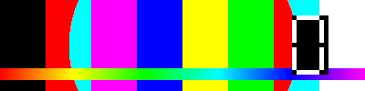

# 站点组件与行内记号

这一页把站点组件的每种写法都摆一遍：同一个组件的不同参数、参数省略后的样子，以及行内记号的四种类型和配色。

## 行内记号

四种记号在同一句里：==高亮==、::check:: 图标、:kbd[Ctrl+B] 按键、:badge[v2]{.tip} 徽章，再加一个表情 :tada:。

配色各来一遍：==警告=={.warning}、==危险=={.danger}、==成功=={.success}、==提示=={.tip}、==信息=={.info}。

按键的三种写法：:kbd[Esc]、:kbd[Ctrl+Shift+P]、:kbd[Cmd+K]。

图标：::check::、::close::、::bell-off::、::search::。

徽章：:badge[稳定]{.success}、:badge[实验]{.warning}、:badge[废弃]{.danger}、:badge[新]{.info}。

## 首屏

:::home-box {title="把文档当页面读" description="一个首屏大块：强调标题、摘要、行动链接和正文都在里面。" href="https://etaf.top/"}
首屏里的正文照常写，列表、代码和链接都能放。
:::

:::home-box {title="只有标题的首屏"}
标题以外的参数都省略时，只剩标题和正文。
:::

:::home-box {title="换一种强调色" description="accent 可以取 success、warning、danger、important 或 neutral。" accent="success" background="sunken"}
底色同样可以换。
:::

## 图片卡片

:::image-card {src="etaf-md-preview-wide.png" title="完整的预览" description="图片在上，标题和说明在下；整张卡片都能点。" href="https://etaf.top/"}
:::

:::image-card {src="etaf-md-preview-media.png" title="只有标题" width="40"}
:::

:::image-card {src="../tests/fixtures/wide-400x100.png" width="52"}
:::

## 卡片网格

:::columns {columns=2}
:::col
:::image-card {src="etaf-md-preview-wide.png" title="网格里的第一张" width="38"}
:::
:::
:::col
:::image-card {src="etaf-md-preview-media.png" title="网格里的第二张" width="38"}
:::
:::
:::

:::columns {columns=2}
:::col
:::link-card {href="https://etaf.top/" title="两张卡片并排" description="每一栏各放一张，卡片自己负责边界和底色。"}
:::
:::
:::col
:::link-card {href="https://github.com/emacs-taf" title="右栏的链接" description="link-card 在栏里自动铺满可用宽度。"}
:::
:::
:::

## 链接卡片

:::link-card {href="https://etaf.top/" title="ETAF 主页" description="整张卡片都可以点，箭头下面是目标地址。"}
:::

:::link-card {href="https://github.com/emacs-taf" title="只有标题和地址"}
:::

## npm 徽章

:::npm-badge {name="etaf-md" version="0.1.0" downloads="1.2k"}
:::

:::npm-badge {name="etaf-ui"}
:::

:::npm-badge {name="etaf" version="0.9.2"}
:::

## 条形图

:::plot {values="5.4,0.33,0.18" labels="打开,缩放,内存" max="6"}
:::

:::plot {values="12,8,5,3,1"}
:::

:::plot {values="3,7,2,9" labels="甲,乙,丙,丁" accent="success"}
:::

## 二维码

:::qrcode {text="https://etaf.top/" title="扫码打开 etaf.top"}
:::

:::qrcode {text="ETAF 把文档当页面读"}
:::

:::qrcode {text="https://github.com/emacs-taf/etaf-md/blob/main/docs/extensions.zh-CN.md" title="长一点的地址也能装下"}
:::

## 轮播

:::swiper
@slide {title="宽图"}

@slide {title="第二张"}
第二页是文字，轮播不只能放图片。
@slide {title="第三张"}

:::

:::swiper
@slide

@slide {selected=true}
第二页默认打开。
:::

## 源码树

:::code-tree {title="三个文件"}
@file lisp/etaf-md-env.el
```elisp
(defun etaf-md-attr (env key &optional node)
  "Return KEY's final value for ENV's block."
  ...)
```
@file lisp/etaf-md-views.el
```elisp
(defun etaf-md--block-view (session key block ref widths)
  ...)
```
@file scripts/etaf-md-gui-probe.el
```elisp
(require 'etaf-md)
```
:::

:::code-tree
@file index.ts
```ts
export const site = 'etaf';
```
@file README.md
```markdown
# ETAF
```
:::

## 包管理器命令

:::npm-to
```sh
npm install -D etaf-md
npm run build
npm uninstall old-package
npm create vue my-app
```
:::

:::npm-to {tabs="npm,pnpm"}
```sh
npm install vue
```
:::

:::npm-to {tabs="pnpm,bun"}
```sh
npm run dev
npx create-vue my-app
```
:::

:::npm-to
```sh
npm ci
npm init
npm install vue && npm run build
```
:::
